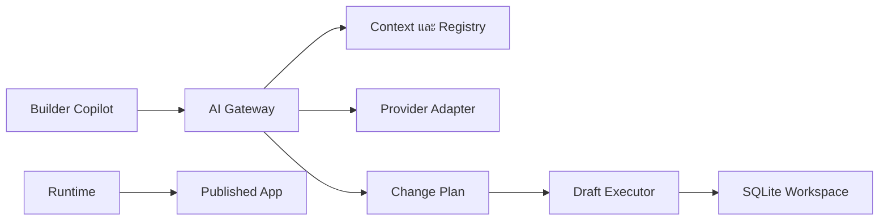
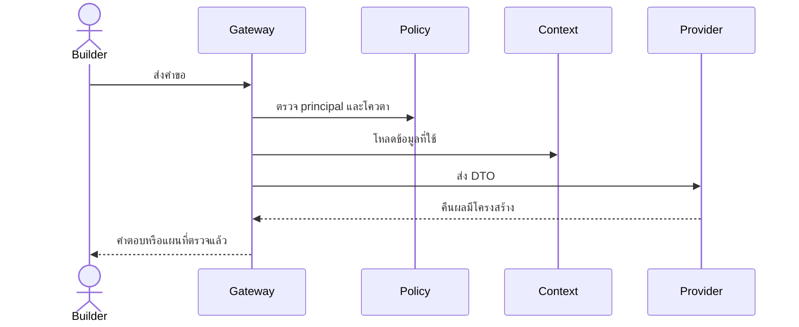
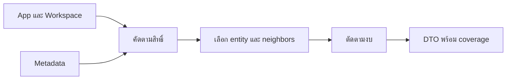
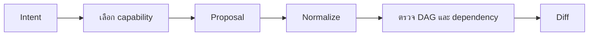
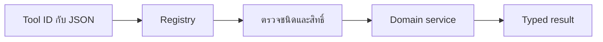
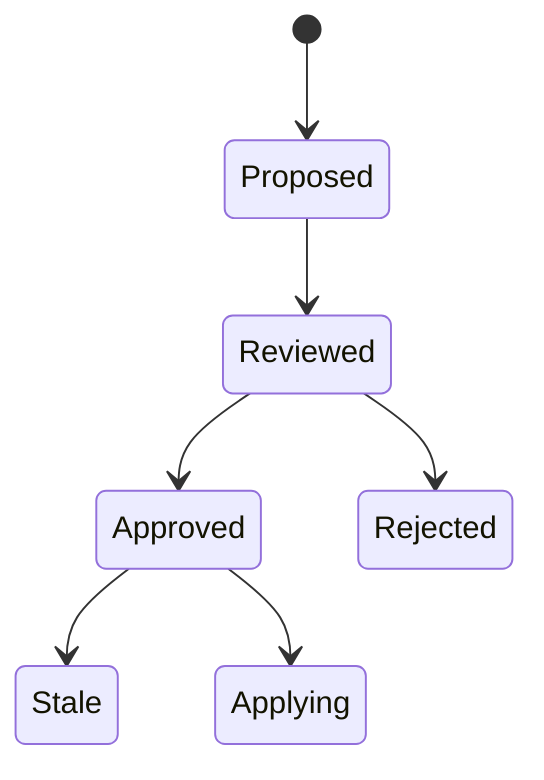
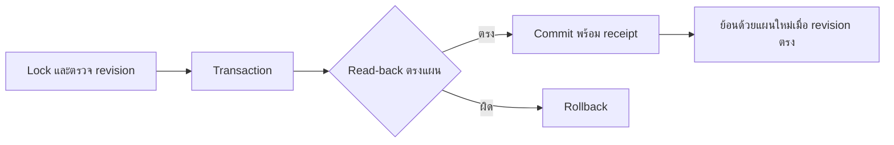
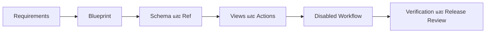
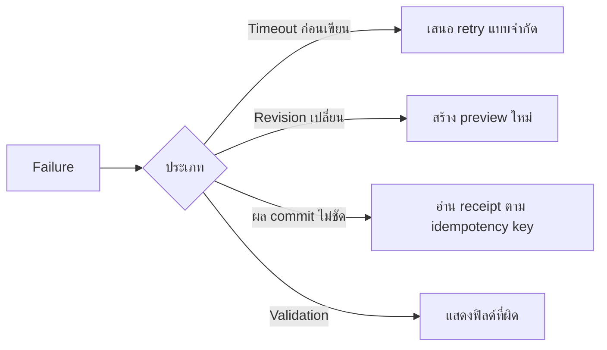

# สถาปัตยกรรมและประสบการณ์ใช้งาน

| แนวทาง | คุณค่าและ UX | ความแม่นยำและความน่าเชื่อถือ | ต้นทุน ความเสี่ยง และการขยาย |
|---|---|---|---|
| A ผู้ช่วยอ่าน | ใช้ได้เร็ว อธิบายและแก้สูตรด้วยตนเอง | จำกัดด้วย context ตรวจผลด้วย parser ได้ | งบต่ำ งานน้อย กระทบสิทธิ์อ่านและการเปิดเผย metadata |
| B Copilot | ลดงานกรอก metadata ผ่านแผนกับการอนุมัติ | ตัวตรวจ deterministic, before/after, read-back | งานปานกลาง ใช้ transaction/workspace เดิม ขยายเป็นชุดงานได้ |
| C Agent | เหมาะกับแผนหลายตอนและงานที่หยุดรอได้ | ต้องบังคับขอบเขต ทวนผลทุกขั้น และป้องกัน loop | สูงทั้งเวลา ผู้ตรวจ โทเคน และผลข้างเคียง คุ้มเมื่อมีงานซ้ำที่ B ทำไม่ทัน |

เลือก B โดยใช้ A เป็นโหมดอ่าน ต่อ C ได้ผ่านการรันแผนที่ได้รับอนุมัติเป็นช่วงสั้น ขยายเฉพาะเมื่อข้อมูล pilot รองรับ

## ส่วนประกอบเป้าหมาย

| ส่วน / ที่ตั้ง | Input → Output และการเชื่อมต่อ | ข้อผิดพลาดและเงื่อนไข / ความยาก 1–5 |
|---|---|---|
| Gateway + Adapter ใน Backend | คำขอที่มี actor → Provider response/usage ผ่าน ai-assist และ adapter กลาง | จำกัดเวลา, จำกัดโทเคน, ตรวจ structured output, แปลง error เป็นรหัส · 3 |
| Conversation / Intent ใน Backend และ Drawer | ข้อความ/selected component → intent + ประวัติย่อ | ลบประวัติได้, แยก app/actor/workspace, ถามเจาะเมื่อคลุมเครือ · 3 |
| Context / Knowledge / Dependency shared module | metadata, diagnostics → projected DTO + edge index | ตรวจสิทธิ์ก่อน cache, budget และ coverage, ปิดเมื่อ scope สูญหาย · 4 |
| Capability Registry / Planner / Orchestrator | context + intent → proposal operations | allowlist, schema version, DAG ไม่มีวง, ref ตรวจจาก server · 4 |
| Policy / Structured Validator | actor + proposal → normalized operation, field errors | deny by default, quoted refs จาก resolver, จำกัด payload/เวลา · 4 |
| Change / Preview / Execution | validated op → diff, approval, transaction → receipt | lock/revalidate/rollback, exclude external side effects, verified read-back · 5 |
| Snapshot / Recovery | metadata ที่ถูกแตะ, revision → restore eligibility | ตรวจการเปลี่ยนหลัง apply, recovery แบบ workspace เมื่อย้อนรายรายการไม่ปลอดภัย · 4 |
| Cost / Observability / Audit shared module | metadata การเรียกและ state → metrics, budget, timeline | redact, เก็บรหัสแทนข้อความ, จำกัดอ่านและอายุข้อมูล · 3 |
| Worker ที่มีอยู่ | job ที่ตรวจสิทธิ์แล้ว → ผล rehearsal/eval ขนาดใหญ่ | cancel/deadline, จำกัด concurrency, ใช้ SQLite แยกในงานทดลอง · 4 |

## Canonical Context และ Capability Registry

ตัวอย่างสัญญาเชิงออกแบบ

```json
{"schemaVersion":1,"appId":"server-resolved","workspaceId":"server-resolved",
 "revision":"metadata-digest","coverage":{"included":12,"omitted":8,"reason":"budget"},
 "selected":{"kind":"column","id":"column:uid"},"entities":[
 {"id":"column:uid","kind":"column","key":"note","type":"text","tableId":"table:uid","capabilities":["column.rule.edit"]}],
 "edges":[{"from":"column:uid","to":"table:uid","kind":"belongs_to","source":"catalog"}],
 "evidence":[{"id":"finding:1","source":"readiness","scope":"current-revision"}]}
```

- Platform ให้รายการความสามารถและเวอร์ชัน registry, Workspace ให้ lineage/revision และผลซ้อม, Application ให้ entity ที่อ่านได้, Module/Component ให้ neighbors ที่ต้องใช้, Conversation ให้ state ที่ผ่านการย่อ, Runtime ให้ metrics รวมจากช่วงที่ระบุ
- ลำดับ retrieval คือ selected ID → exact internal name → edge ที่ต้องใช้ → relevance จาก label → evidence แบบรวม พร้อมตัวเลขรายการที่ตัดออก ใช้ projection และ pagination ของ metadata งบเริ่มต้น 12k input tokens สำหรับแผน Context cache key รวม app/workspace/principal/permission digest/revision/registry version พร้อม TTL และ invalidate หลังแก้หรือถอนสิทธิ์
- ใช้ UID จาก developmentOrigins ใน workspace เมื่อมี lineage ใช้ keys ของ metadata ปัจจุบันร่วมกับ revision เมื่อยังไม่มี UID ถาวรใน live และวาง migration immutable ID หลังพิสูจน์ความจำเป็น การสร้าง/rename ต้อง resolve ด้วย ID เดิมหรือคืน stale conflict การคัดลอกแอปสร้าง namespace ใหม่
- Registry ให้ owner และ validator ของแต่ละ capability เช่น ชนิดตารางมาจาก _tables/source_kind, คอลัมน์จาก SQLTYPE/normalizeColumns, View จากตัวตรวจส่วน View, Action/Workflow จาก action-config/workflow-validation, แหล่งข้อมูลจาก external-data-config และ UI จาก custom-page. ฟังก์ชันและตัวดำเนินการอิง parser/FUNCTION_NAMES ใช้ formula guide เสริม syntax/parameter/type/example และรักษาคำเตือนด้าน performance แยกจากกฎ parser
- ตัวอย่าง COUNT มี syntax COUNT(list), รับ List, คืน Number, COUNT(LIST(1,2)) ได้ 2, ประเมิน list ก่อนนับ และต้นทุนขึ้นกับวิธีโหลด list Registry ต้องมี contract test สำหรับชื่อ ตัวอย่าง และผลลัพธ์กับ Engine จริงก่อนส่งให้โมเดล
- ส่งเฉพาะ DTO ที่อนุญาต ไม่ส่งแถวฐานข้อมูล, ไฟล์, คีย์ หรือ raw logs ใช้ graph จาก metadata และ parser ก่อนพิจารณา embeddings ทดลอง RAG เมื่อคำถามเกี่ยวกับเอกสารนอก catalog มีอัตราค้นพลาดที่วัดได้และมี ACL ตลอดการเรียกคืน

## Mermaid

### 1 ภาพรวม


### 2 วงจรคำขอ


### 3 บริบท


### 4 สร้างแผน


### 5 เรียกเครื่องมือ


### 6 รีวิวและอนุมัติ


### 7 ผลและย้อนกลับ


### 8 ขอบเขตสิทธิ์


### 9 สร้างแอป


### 10 จัดการข้อผิดพลาด


## UX และ ADR

Wireframe แบบข้อความตาม Drawer เดิม

```text
[Copilot] [แอป · พื้นที่พัฒนา] [เลือกคอมโพเนนต์] [ขยาย]
[Ask] [Analyze] [Plan] [Build] [Fix] [Optimize] [Summarize]
ข้อความและลิงก์อ้างอิงกลับไปยัง Builder
การ์ดแผน | ขอบเขต | คำเตือน | ก่อน → หลัง | ผลตรวจ
[ตรวจแผน] [อนุมัติ] [ปฏิเสธ] [เปิดผลลัพธ์] [ย้อนแผนเมื่ออนุญาต]
[ช่องพิมพ์] [ส่ง] [ยกเลิก] [ขอบเขตและการใช้งาน]
```

Global Drawer ใช้กับงานข้ามตาราง Contextual Assistant ใช้เมื่ออยู่ใน Formula/View/Workflow editor โดยส่ง selected ID ผ่านเส้นทางเดียวกัน แสดงสถานะกำลังโหลดบริบท → ร่าง → ตรวจ → รอยืนยัน → ใช้ → ตรวจผล Streaming ใช้กับคำอธิบายหลังตรวจ ส่วน diff และ action แสดงเมื่อ JSON ผ่าน validator ใน MVP เปิด Ask/Analyze/Plan/Build เท่าที่รองรับ Fix/Optimize/Summarize ขยายตาม Roadmap

**ลำดับใช้งาน** Ask เริ่มจากเลือกคอมโพเนนต์หรือพิมพ์ชื่อด้วย @ แล้วแสดงลิงก์หลักฐานในคำตอบ Analyze/Optimize เลือกช่วงการวัดและเห็นผลที่ตรวจได้พร้อมรายการที่หาไม่พบ Plan/Build ดูรายการก่อน–หลังแบบขยายแต่ละคอมโพเนนต์ได้ เมื่อเปลี่ยนแอประหว่างร่างให้กลับไปที่แผนใน scope เดิมหรือสร้างใหม่ กรณี conflict แสดง revision ของแผนและเหตุที่ต้องตรวจซ้ำ กรณีขาดการเชื่อมต่อหลังยืนยันให้ปุ่มเปิดสถานะดึง receipt ก่อนเสนอ retry หรือ undo

| ADR / บริบท | ตัดสินใจและเหตุผล | ผลตามมา ความเสี่ยง ทางขยาย |
|---|---|---|
| 01 Metadata หรือ RAG | Metadata projection และ graph เพื่ออิงชื่อ/ID จริงและ ACL | ต้องเพิ่ม edges จาก parser ขยาย RAG เฉพาะคลังเอกสารที่วัดว่าขาด |
| 02 Single หรือ multi-agent | Planner เดียวและ Executor deterministic ลดค่าและการตรวจ | parallel read-only checks ได้ เมื่อมี evidence ว่าคุ้ม |
| 03 เรียก service ตรงหรือ gateway | Registry adapter ครอบ service เดิมสำหรับ policy แบบเดียว | ต้อง refactor logic ที่ฝังใน route ทีละตัว คง API เดิม |
| 04 Sync หรือ async | แผนสั้น synchronous งาน rehearsal/load ใช้ worker | จำกัดเวลาถือ write lock แยก worker เมื่อมีคิวหรือ SLA |
| 05 Full หรือ selective context | Selective ตามสิทธิ์และ budget | บอก coverage และขยายหน้าตามคำถาม |
| 06 Snapshot หรือ inverse | Transaction ตอน apply, inverse เฉพาะ metadata ที่ตรวจ revision ได้, ใช้ snapshot/workspace recovery ในงานอื่น | คืนทุกอย่างได้ทันทีเฉพาะก่อน commit หลัง commit มีข้อจำกัด |
| 07 Provider เดียวหรือหลายราย | Adapter กลาง deploy รุ่นเดียวต่อ app policy และ eval ก่อนสลับ | fallback เฉพาะที่อนุมัติ หลีกเลี่ยงการส่งซ้ำต่างผู้รับ |
| 08 Monolith หรือ Service แยก | Modular monolith เหมาะกับ SQLite/transactions และทีมปัจจุบัน | แยก inference/worker หลังวัดการแย่งทรัพยากรและต้นทุน |
