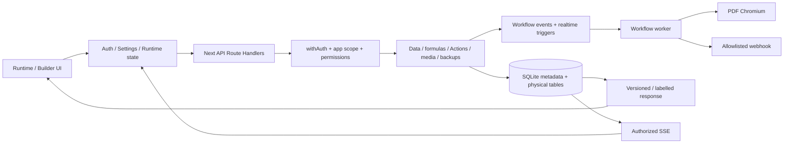

# System Audit Report

**วันที่:** 29 ตุลาคม 2026 (Asia/Bangkok)  
**สถานะ:** Audit baseline completed — Source Code ไม่ถูกแก้ไข  
**Repository:** App-Builder (Next.js / React / SQLite)

## Executive result

ตรวจ discovery/static แบบมุ่งความเสี่ยงครบ **25 Modules** มี runtime evidence สำหรับ **24 Modules** และ static-only **1 Module**. ผลตามขอบเขตที่ตรวจ: **14 PASS, 8 FAIL, 2 PARTIAL, 1 NOT TESTED**. บัคหนึ่งข้อกระทบหลาย Module ได้ จึงไม่เท่ากับจำนวนบัค

พบ **7 Confirmed Findings**: **P1 = 3**, **P2 = 4**; แยก **5 Design Risks**, **2 Suspected Issues** และรายการ Not Tested ไว้ชัดเจน. ไม่มีการพิสูจน์ P0 exploit หรือข้อมูลสูญหายกับระบบจริง. Dependency registry มี critical advisory; applicability/exploitation ต้องแยกจากการยืนยัน version ที่ได้รับผลกระทบ

สามเรื่องที่ควรจัดการก่อน external production rollout คือ **สิทธิ์ดาวน์โหลดไฟล์ข้ามแอป**, **global Login quota ที่นับ success** และ **framework dependencies ที่มี advisories**. ยังไม่ได้แก้ปัญหาเหล่านี้ใน Audit Mode

## เอกสารส่งมอบ

1. [BUG_REPORT.md](BUG_REPORT.md) — severity, confidence, File:Line, root cause, reproduction, expected/actual, impact, proposed fix/regression
2. [TEST_COVERAGE_MATRIX.md](TEST_COVERAGE_MATRIX.md) — Modules, actual suite results, gaps and approval-gated test plan
3. [SECURITY_FINDINGS.md](SECURITY_FINDINGS.md) — confirmed security issues versus controls/conditions not proven
4. [FIX_PLAN.md](FIX_PLAN.md) — concrete prioritized changes and gates; proposal only
5. รายงานฉบับนี้ — discovery/inventory/dependency/interaction maps and audit progress

## ขอบเขตและความปลอดภัยของการตรวจ

- Source ที่ใช้ตรวจเป็น frozen copy ของ source/config/test assets **737 ไฟล์** ในโฟลเดอร์ Audit แยก ใช้ installed node_modules เดิมผ่าน read-only-use junction; ไม่ install/prune/update dependency
- ไม่อ่าน/แก้ data.db จริง, backups จริง, uploads จริง, credentials/.env, Docker volumes หรือส่งข้อมูลไป external webhook/email/cloud จริง
- ทดสอบการเปลี่ยนข้อมูลด้วย in-memory DB หรือ integration DB ใหม่เฉพาะการตรวจ รวมถึง local mock webhook server ในชุดเดิม
- ไม่เพิ่ม/แก้ไฟล์ทดสอบหรือ Source Code; inline diagnostic probes รันเฉพาะ fixture และบันทึกเป็น evidence JSON ไม่ติดตั้งเป็น test source
- Build/Test อาจสร้าง generated artifacts เฉพาะสำเนาแยก ไม่ใช้ production build directory ของต้นฉบับ
- ตรวจ hash ต้นฉบับ **737 ไฟล์: เปลี่ยน 0 ไฟล์**. [Integrity evidence](evidence/integrity.json)
- การเปลี่ยนใน Repository รอบนี้จำกัดที่โฟลเดอร์รายงาน Audit และ evidence ที่ผ่านการตัด email/token/path ส่วนบุคคลออก ไม่มีข้อมูลจากฐานจริง
- ไม่อ่านโค้ดแล้วสรุปว่า runtime ผ่าน; PASS ทุก Module อ้างถึงการทดสอบที่ระบุและจำกัดความหมายไว้ใน Coverage Matrix

## PHASE 1 — System discovery

### โครงสร้างที่พบ

| ส่วน | หน้าที่ / หลักฐาน |
|---|---|
| app/ | Next App Router: 25 page.tsx; Runtime, Builder, My Apps และหน้าจัดการ |
| app/api/ | **50 route files / 89 detected exported HTTP methods**, delegated views route resolved manually |
| app/app/[appId]/ | PWA identity/login, manifest, offline และ service worker: 3 route files เพิ่มจาก API |
| app/components/ | RuntimeTable, RuntimeTransition, forms/detail/inline, special/custom views, auth/settings providers |
| lib/ | **128 library files**: schema, permissions, app boundaries, formulas, workflows, files, backup, cache/PWA, metrics |
| tests/ | **213 files** including helpers/unit/API/browser suites; ไม่ได้รันทุก browser file |
| scripts/ | Existing unit compiler/runner, isolated Next integration server, test authentication preload and diagnostics |
| deploy/ + root Docker files | Linux Compose/Caddy/backup/bootstrap/health; static inspected only |
| docs/ | Existing feature documentation plus this audit; documentation is not runtime evidence |

Static import/export inventory: **307 TS/TSX files, 1,725 edges**, excludes root-entrypoint/dynamic-edge resolution from that raw count. Complete file-level edges and route metadata: [source inventory](evidence/source-inventory.json)

### Framework / dependencies / test framework

- Next.js **14.2.15**, React **18.3.1**, TypeScript; App Router and Node Route Handlers
- better-sqlite3, synchronous SQLite queries/transactions; no separate ORM migration engine
- ExcelJS exports/imports, Leaflet/OSM maps, ZXing scanner, Playwright Chromium/PDF
- Opaque session cookies with server-side hashed token lookup; no JWT authentication contract
- Node Test runner compiled by scripts/test.cjs; Playwright suites via scripts/integration.cjs
- Repository tsconfig has strict:false; selected library test compilation uses strict checking. Base typecheck passed, supplementary unused diagnostics failed with 36 items. No standalone ESLint script/config/dependency was installed or run
- Dependency audit flags Next/PostCSS: [registry evidence](evidence/dependency-audit.json). Vendor corroboration in SECURITY_FINDINGS.md; this is not proof of every exploit path

### Database models / migration map

A fresh **in-memory** initialization produced **38 system tables and 40 FK definitions**. [Schema-only inventory](evidence/models.json) contains names, types, PK/FK/index metadata and no account or business rows

| Model group | Tables / routing | Interaction |
|---|---|---|
| Accounts/session | _users, _user_profiles, _sessions, _auth_attempts, _roles | Login → session lookup → access evaluation |
| Legacy grants | _role_tables, _role_actions, _role_row_rules | Migration/compatibility before separated app membership |
| App boundaries | _applications, _application_datasets, _application_builders, _application_members, _application_local_roles, app role grants | App scope + role + dataset ceilings + row rules |
| Dynamic schema | _tables, _columns, t_<table> | Metadata validated into physical SQL schema; data and Ref IDs |
| Per-app configuration | _views, _slices, _actions, _app_settings, _pdf_templates and namespaced copies | applicationSql/applicationTable route logical config to app namespace |
| Background jobs | _automations, _automation_jobs and per-app copies | Request events / schedules → queue → worker → data/file/webhook checkpoints |
| Media | _files, _images, upload-owner tables, _media_catalog | DB bytes, optional disk mirror, reference/access/provenance checks |
| Audit/usage | _audit_log, _app_usage | Builder diffs vs runtime usage events; retention and owner reporting |
| Versions/realtime | _app_versions, _realtime_versions, user setting tables | Publish/revert catalogs, settings, SSE change versions |

Migrations are conditional schema additions/rebuilds inside lib/schema.ts and auth/application/list/realtime helpers. Existing unit/API/conversion/restore fixtures exercised selected old/new schema paths, key/Ref preservation and rollback. No live schema or migration was executed

### Feature inventory / module coverage

| ID | Feature | Status | Primary source | Evidence scope |
| --- | --- | --- | --- | --- |
| M01 | Framework / dependencies | FAIL | package.json; next.config.mjs; middleware.ts | Type/build + registry audit |
| M02 | Authentication / accounts / profile | FAIL | lib/auth.ts; auth-schema.ts; app/api/auth | Unit + runtime login probe |
| M03 | Authorization / app-table-row boundaries | FAIL | lib/auth-api.ts; permissions.ts; row-access.ts | approles + HTTP negative probe |
| M04 | Schema / migration / conversion | PASS | lib/schema.ts; column-conversion.ts; unique.ts | Unit + API suite |
| M05 | CRUD / Ref / cascade / child forms | PASS | data-write.ts; delete-record.ts; part-of-records.ts; form-save.ts | Unit + API + concurrentedit |
| M06 | Expressions / data types / validation | PASS | expression.ts; columns.ts; duration.ts; scalar-fields.ts; barcode.ts | Unit + valuetypes |
| M07 | View builder / tabs / groups / filters | FAIL | view-api.ts; view-display.ts; ViewDataTabs.tsx | quickfilters + selected-more browser probe |
| M08 | Runtime navigation / form/detail/inline | PASS | RuntimeTransition.tsx; RuntimeTable.tsx; runtime-page-stack.ts | navcontract + mapdesign + concurrentedit |
| M09 | Dashboard / Map / Calendar / Chart | PASS | RuntimeViewRenderer.tsx; SpecialRuntimeView.tsx; special-view-data.ts | mapdesign + quickfilters |
| M10 | Custom page designer/runtime | PASS | custom-page.ts; custom-page-references.ts; CustomRuntimeView.tsx | Unit + custompagev2 |
| M11 | Actions / ordered values / business writes | PASS | automation.ts; action-config.ts; form-save.ts | Unit + API + approles |
| M12 | Automation / schedules / webhook | PARTIAL | workflows.ts; workflow-runner.ts; workflow-config.ts | Unit + workflows E2E until final failure |
| M13 | PDF generation / designer | FAIL | pdf-report.ts; pdf-design-html.ts; workflow-runner.ts | Unit + PDF steps executed before workflows final failure + SQL probe |
| M14 | Images / attachments / file inventory | FAIL | permissions.ts; files.ts; images.ts; media-inventory.ts | Unit + appoperations + HTTP file probe |
| M15 | Excel import/export and permissions | PARTIAL | excel.ts; app/api/excel; Excel UI | API + approles + valuetypes + partial exceloptions |
| M16 | Applications / clone / delete / role membership | PASS | applications.ts; application-lifecycle.ts; application-roles.ts | Unit + approles + applifecycle |
| M17 | Backup / restore / account remapping | PASS | backups.ts; backup-stages.ts; application-backups.ts; restore-applications.ts | Unit + restoreapps + appoperations |
| M18 | Audit / user usage history | PASS | audit-schema.ts; audit-log.ts; app-usage.ts; AppOperationsManager.tsx | Unit + appoperations |
| M19 | Realtime / authorization refresh | PASS | realtime-schema.ts; app/api/realtime; Runtime realtime client | Unit + realtime + approles |
| M20 | Cache / IndexedDB / PWA | PASS | runtime-cache.ts; runtime-storage.ts; pwa-worker.ts; pwa-server.ts | Unit + pwa + navcontract |
| M21 | Diagnostics / system report / readiness | PASS | system-report.ts; performance-report.ts; readiness.ts | Unit + systemreport + readinessperf |
| M22 | Docker / Linux / Caddy / cold backup | NOT TESTED | Dockerfile; compose.yaml; deploy/* | Static review only |
| M23 | Test infrastructure / regression gates | FAIL | scripts/test.cjs; scripts/integration.cjs; tests | Actual selected suites + invalid mode execution |
| M24 | Performance / scalability | FAIL | user-fields.ts; media-inventory.ts; expression-context.ts | 10,000-row E2E + SQL-count/timing probes |
| M25 | Draft / release / rollback isolation | PASS | releases.ts; draft-request.ts; simulation.ts | Existing unit request/database isolation and release checks + static tracing |

### Dependency and interaction maps

Security-sensitive boundaries are cross-cutting: UI Show_If does not authorize a request; app selection narrows datasets; table/row permissions apply at service writes; images/files are global bytes requiring separate guards. AUD-001 is a failure at that last boundary despite correctly denied source-table access

**State/data flow examples actually traced:**

1. Form → saveFormRecord/writeRecord → permissions/version/Ref/editability/value validation → immediate transaction → child groups and Action/Workflow → response/cache/SSE → UI. API/concurrentedit/valuetypes exercised success, rejection and rollback
2. App role → applicationScopeFor/accessFor → rowAllowed/Action/Excel grants → runtime and SSE. approles passed scoped scenarios; synthetic cross-app file HTTP probe found a bypass
3. Scoped backup → export fresh DB → inspect/rebuild trusted ready DB → account matching/new app+table/media mapping → disabled Automation → result. appoperations/restoreapps passed small fixtures; high-volume restore and disk-full untested
4. Automation → snapshot/config/actor validation → action/webhook/PDF → checkpoint and file/write results. Existing mock side-effect steps ran, but workflows suite failed at final legacy file selector; full suite remains failed
5. Runtime → API/cache/retained route → navigation → back/close. navcontract, mapdesign, PWA and dirty-form conflict scenarios completed on simulated devices

### Dead code / duplicate logic / unused APIs

- Supplementary compiler found **36 unused import/local/parameter diagnostics**, not 36 proven runtime bugs. [Diagnostics](evidence/unused.log)
- Raw static graph initially identified request-origin.ts and workflow-runner.ts as unreferenced; root middleware and dynamic instrumentation explain them. Neither is confirmed dead code
- No API is labeled unused just because literal frontend fetch strings were absent; dynamic routes, PWA and external clients make that inference unsafe
- Duplicated policy/validation areas worth consolidation: image versus file guards (confirmed behavioral divergence), manual JSON/multipart size checks, full versus scoped backup staging, and repeated User lookup logic. Recommendations must preserve app/actor scope rather than creating shared authorization caches

### API inventory

Guard column is an indicator, not a guarantee. Route-local auth endpoints and delegated exports were manually resolved. PWA branding/manifest/offline/SW handlers are intentionally public surfaces and do not contain business row output in the reviewed contract

| Route file | HTTP exports | Guard / entrypoint |
| --- | --- | --- |
| `app/api/actions/route.ts` | GET, POST, PUT, DELETE | withAuth + endpoint/service rules |
| `app/api/app-activity/route.ts` | POST | withAuth + endpoint/service rules |
| `app/api/app-icon/route.ts` | GET | Public/session/setup handler by design; manual review required |
| `app/api/app-management/route.ts` | GET, DELETE | withAuth + endpoint/service rules |
| `app/api/application-access/route.ts` | GET | withAuth + endpoint/service rules |
| `app/api/applications/route.ts` | GET, POST, PUT, DELETE | withAuth + endpoint/service rules |
| `app/api/audit-log/route.ts` | GET | withAuth + endpoint/service rules |
| `app/api/auth/login/route.ts` | POST | Public/session/setup handler by design; manual review required |
| `app/api/auth/logout/route.ts` | POST | Route-local session/origin checks; inspect semantics |
| `app/api/auth/profile/route.ts` | GET, PATCH | Route-local session/origin checks; inspect semantics |
| `app/api/auth/session/route.ts` | GET | Public/session/setup handler by design; manual review required |
| `app/api/auth/setup/route.ts` | POST | Public/session/setup handler by design; manual review required |
| `app/api/backups/application/route.ts` | GET, POST | withAuth + endpoint/service rules |
| `app/api/backups/restore/route.ts` | POST, DELETE | withAuth + endpoint/service rules |
| `app/api/backups/route.ts` | GET, POST | withAuth + endpoint/service rules |
| `app/api/backups/[name]/route.ts` | GET | withAuth + endpoint/service rules |
| `app/api/branding/route.ts` | GET | Public/session/setup handler by design; manual review required |
| `app/api/data/[table]/clear/route.ts` | POST | withAuth + endpoint/service rules |
| `app/api/data/[table]/route.ts` | GET, POST, PUT, DELETE | withAuth + endpoint/service rules |
| `app/api/data/[table]/validate/route.ts` | POST | withAuth + endpoint/service rules |
| `app/api/excel/[table]/route.ts` | GET, POST | withAuth + endpoint/service rules |
| `app/api/expression-data/route.ts` | GET, POST | withAuth + endpoint/service rules |
| `app/api/field-users/route.ts` | GET | withAuth + endpoint/service rules |
| `app/api/files/route.ts` | POST | withAuth + endpoint/service rules |
| `app/api/files/[id]/route.ts` | GET | withAuth + endpoint/service rules |
| `app/api/health/route.ts` | GET | Public/session/setup handler by design; manual review required |
| `app/api/images/route.ts` | POST | withAuth + endpoint/service rules |
| `app/api/images/[id]/route.ts` | GET | withAuth + endpoint/service rules |
| `app/api/lists/[table]/route.ts` | GET, POST | withAuth + endpoint/service rules |
| `app/api/pdf-templates/route.ts` | GET, POST, PUT, DELETE | withAuth + endpoint/service rules |
| `app/api/performance/route.ts` | GET | withAuth + endpoint/service rules |
| `app/api/readiness/route.ts` | GET, POST | withAuth + endpoint/service rules |
| `app/api/realtime/route.ts` | GET | withAuth + endpoint/service rules |
| `app/api/releases/route.ts` | GET, POST | withAuth + endpoint/service rules |
| `app/api/scan/[table]/route.ts` | POST | withAuth + endpoint/service rules |
| `app/api/settings/route.ts` | GET, PUT | withAuth + endpoint/service rules |
| `app/api/slices/route.ts` | GET, POST, PUT, DELETE | withAuth + endpoint/service rules |
| `app/api/system-report/route.ts` | GET | withAuth + endpoint/service rules |
| `app/api/tables/route.ts` | GET, POST | withAuth + endpoint/service rules |
| `app/api/tables/[name]/convert/route.ts` | POST, PUT, DELETE | withAuth + endpoint/service rules |
| `app/api/tables/[name]/duplicates/route.ts` | GET | withAuth + endpoint/service rules |
| `app/api/tables/[name]/raw/route.ts` | GET | withAuth + endpoint/service rules |
| `app/api/tables/[name]/route.ts` | PATCH, DELETE | withAuth + endpoint/service rules |
| `app/api/user-settings/route.ts` | GET, PUT, POST | withAuth + endpoint/service rules |
| `app/api/users/route.ts` | GET, POST | withAuth + endpoint/service rules |
| `app/api/view-data/[table]/route.ts` | GET | withAuth + endpoint/service rules |
| `app/api/views/preview/route.ts` | POST | withAuth + endpoint/service rules |
| `app/api/views/route.ts` | GET, POST, PUT, DELETE | Delegated withAuth |
| `app/api/workflows/files/[id]/route.ts` | GET | withAuth + endpoint/service rules |
| `app/api/workflows/route.ts` | GET, POST, PUT, DELETE | withAuth + endpoint/service rules |

PWA additions: `app/app/[appId]/manifest.webmanifest/route.ts`, `app/app/[appId]/offline/route.ts`, `app/app/[appId]/sw.js/route.ts`

## PHASE 2 — Static audit

Reviewed source paths for identifiers/parameter binding, auth/app/row boundaries, transactions, child writes, type/date normalization, errors, request/response limits, SQL query patterns, unsafe HTML/URL handling, async cancellation, worker cleanup and caching scope. Baseline typecheck and production build completed on the frozen copy. No standalone lint configuration was assumed to exist

Important results: file guard bypass (AUD-001), login global quota (AUD-002), dependency ranges (AUD-003), forced selected-chip count (AUD-005), runner fallback (AUD-006), User lookup amplification (AUD-007). Static-only risks are separated in BUG_REPORT: byte/memory budgets, inventory scans, optional version policy, external-effect consistency and unused diagnostics

## PHASE 3 — Business logic and integration

Existing tests exercised positives, negatives, required/type/key/Ref boundaries, unauthorized/revoked users, stale previews/versions, child rollback, account remapping, dirty form preservation, mock network failures and offline/reconnect. Not all combinations and user-specific configurations are covered. Detailed layer-by-layer failures and expected/actual values are in BUG_REPORT and evidence JSON

## PHASE 4 — Actual automated results

- **Unit: 323 passed / 0 failed**
- **Repository typecheck: PASS**; **production build: PASS** (snapshot and isolated DB path only)
- **Supplementary unused checks: 36 diagnostics**, not enabled by repository baseline
- **Selected valid Integration/API/E2E: 20 suites / 16 PASS / 4 FAIL**
- Default API suite: **15 tests passed / 0 failed**. Repeated default runs from invalid modes are excluded from additional coverage
- Failed suites: permissions (legacy heading), workflows (exact old attachment href), exceloptions (legacy role card), readiness (legacy builder Automation-skipped expectation). Full traces retained; neither test source nor product source was changed to make them green
- Approved-scope inline probes additionally demonstrated cross-app file read, global success-login lock, selected-more count mismatch and measured SQL amplification. No new test files were added

All suite Expected/Actual records: [test-results.json](evidence/test-results.json) and TEST_COVERAGE_MATRIX.md. PASS indicates that fixture's assertions, not production correctness or full statement coverage

### Performance evidence

Local synthetic 10,000-row test: API first page **12 ms**, mobile search assertion **384 ms**, Dashboard initial assertion **617 ms**, **200 rendered rows** in that scenario. User labels: **12,020 SQL statements / 118 ms** for 20 resolutions with 100 users. Media inventory: **1,016 statements / 12 ms** for 1,000 entries; scanning one image's 10,000 references **296 ms**

These are measurements from one Windows test environment, not p95/p99, a multi-user benchmark, a claim about 1M rows, or a deployment SLA. See [performance evidence](evidence/performance-reproductions.json) and [existing 10k test](evidence/readinessperf.log)

## PHASE 5 — Classification

- Confirmed: AUD-001 through AUD-007, with separate confidence for package version versus exploitability
- Design Risk: DR-001 through DR-005; measured scans and code risks are not falsely promoted to proven data loss/OOM
- Suspected: SUS-001 proxy/TLS semantics; SUS-002 formula snapshot scale boundary
- Not Tested: production, actual Linux/Docker, physical iPhone, huge payload/volume/load, real external services, broad exploit payloads and remaining browser suites

## PHASE 6 — Handoff / progress record

1. Discovery plan presented from actual repository; initial page/API/library/test inventory collected
2. Safe source snapshot created, credentials/data/volumes excluded
3. Unit/type/build and registry audit performed; risk-focused static/service tracing recorded
4. Existing suites run module by module; failing suites retained with actual error logs
5. Security/UI/performance hypotheses reproduced with synthetic runtime probes where feasible
6. Supplementary unused scan and schema/import/API inventories generated
7. Five final reports plus sanitized evidence produced; source integrity hash check found no change

**Next action requires approval:** implement the concrete P1/P2 fixes and proposed regression files in FIX_PLAN. No production operation or source fix was performed as part of this audit
