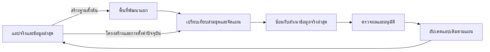

# ออกแบบพัฒนาแอปควบคู่กับการใช้งานจริง

วันที่ตรวจ: 12 พฤศจิกายน 2569

สถานะ: แบบออกแบบจากโค้ดจริง ยังไม่ได้เปิดใช้การเผยแพร่โครงสร้างหรือเปลี่ยนฐานข้อมูลจริง

## เป้าหมายและขอบเขต

นักพัฒนาทดลองเปลี่ยนตาราง คอลัมน์ สูตร หน้าจอ และกระบวนการทำงานในพื้นที่แยก ขณะที่ผู้ใช้ทำงานในแอปจริงได้ต่อ เมื่อผ่านการทดสอบ จึงนำเฉพาะการเปลี่ยนโครงสร้างและการตั้งค่ากลับเข้าแอปเดิม โดยรักษาข้อมูลล่าสุด รหัสแอป ลิงก์ สมาชิก และประวัติเดิมไว้

เอกสารนี้ออกแบบการเปรียบเทียบ การจัดลำดับอัปเดต การซ้อม และการเผยแพร่ ไม่ใช่การยกเลิกข้อจำกัดฉบับร่างเดิมทันที งานเปลี่ยนโครงสร้างบางชนิดยังต้องพักการเขียนข้อมูลช่วงสั้น ไม่รับประกันว่าไม่มีช่วงหยุดทุกกรณี

## สิ่งที่มีอยู่จริง

| เรื่อง | หลักฐานในโค้ด | ผลต่อการออกแบบ |
|---|---|---|
| ฉบับร่างสำเนาฐานข้อมูลด้วย `VACUUM INTO` | `lib/releases.ts` ฟังก์ชัน `createDraft` | ใช้ข้อมูล ณ เวลาสร้าง ไม่ใช่ข้อมูลจริงที่ปรับตามตลอดเวลา และสำเนาอาจมีข้อมูลมากกว่าหนึ่งแอป |
| แยกการทำงานด้วยบริบทฐานข้อมูล | `lib/db.ts` ฟังก์ชัน `withDatabase` | นำกลับมาใช้เป็นขอบเขตการซ้อมได้ ต้องทดสอบทุกเส้นทางที่เข้าถึงฐานข้อมูล |
| แยกตารางการตั้งค่าตามแอป แต่ตารางข้อมูลอยู่ใน SQLite ไฟล์เดียว | `lib/db.ts`, `lib/application-context.ts` | งานเขียนโครงสร้างอาจกระทบเวลารอของแอปอื่น การกู้คืนทั้งไฟล์อาจย้อนข้อมูลของทุกแอป |
| ป้องกันเพิ่ม ลบ และแปลงโครงสร้างในฉบับร่าง | `lib/draft-request.ts` ฟังก์ชัน `withDraftRequest` | คงข้อจำกัดนี้จนกว่าจะมีตัววางแผนและตัวอัปเดตที่ผ่านการทดสอบ |
| เผยแพร่เฉพาะรายการการตั้งค่าที่กำหนดใน `META` | `lib/releases.ts` ฟังก์ชัน `catalog`, `applyCatalog`, `publishDraft` | ยังไม่มีการย้ายโครงสร้าง ไม่ย้ายข้อมูลแถวทดลอง สมาชิก หรือรหัสผ่านกลับเข้าแอปจริง |
| ตรวจฉบับร่างเปลี่ยนหลังรีวิวและการตั้งค่าจริงเปลี่ยนหลังสร้างร่าง | `lib/releases.ts` ตัวแปร `review_hash`, `base_hash` | ขยายเป็นการตรวจสามชุด โดยไม่ยกเลิกการป้องกันเดิม |
| ตรวจร่างใช้สิทธิ์ผู้พัฒนา และร่างเป็นของผู้สร้าง | `app/api/releases/route.ts`, `lib/releases.ts` ฟังก์ชัน `draftManifest` | แยกสิทธิ์ตรวจแผนและเผยแพร่ แต่ยังตรวจสิทธิ์ปัจจุบันทุกคำขอ |
| Clone มีฐานข้อมูลใหม่และใช้ตารางร่วม | `lib/application-lifecycle.ts` ฟังก์ชัน `cloneApplication` | พื้นที่พัฒนาต้องใช้ข้อมูลแยก การใช้ตารางร่วมไม่ใช่พื้นที่ทดลองเขียนข้อมูล |
| Clone เปลี่ยนชื่อตารางและแปลงสูตรตามการจับคู่ | `lib/application-lifecycle.ts`, `lib/application-clone-config.ts` | ห้ามจับคู่แอปต้นทางกับ Clone ด้วยชื่อแสดง ต้องเก็บสายกำเนิดและการจับคู่ไว้ |
| มีการตรวจและแปลงชนิดคอลัมน์ | `lib/column-conversion.ts` | ใช้ตัวตรวจและตัวแปลงเดิม ไม่สร้างกฎแปลงค่าอีกชุด และไม่ถือว่าผลตรวจเก่ายังใช้กับข้อมูลล่าสุดได้ |
| มีการตั้งค่าเฉพาะแอปของตารางร่วมและตรวจโครงสร้างต้นทาง | `lib/shared-table-columns.ts` | แยกการเปลี่ยนคอลัมน์จริงของเจ้าของกับสูตรหรือ Label ของผู้เชื่อม |
| มีสำรองรายแอปและการคืนเป็นแอป | `lib/application-backups.ts` | ใช้ประกอบการซ้อมได้ แต่การคืนสำรองยังไม่ใช่การรวมรุ่นพัฒนาเข้าแอปเดิม |

รายการนี้เป็นผลตรวจโค้ด การทดสอบระบบเดิมและข้อจำกัดที่ยังไม่ได้ทดสอบระบุในเอกสารแผนทดสอบแยกต่างหาก

## แยกเวอร์ชั่นให้ผู้ใช้เข้าใจ

| ชนิด | ตัวอย่าง | วิธีนำขึ้นใช้งาน |
|---|---|---|
| รุ่นตัวแพลตฟอร์ม | แก้เครื่องมือ PDF หรือประสิทธิภาพสูตรในโค้ด | ทดสอบโค้ดและนำ Docker Image รุ่นใหม่ขึ้นเซิร์ฟเวอร์ |
| รุ่นแอป | เปลี่ยนหน้าจอ สูตร Action และตารางของแอปหนึ่ง | ตรวจแผนและเผยแพร่ผ่านเวอร์ชั่นแอป |
| ข้อมูลธุรกิจ | ผู้ใช้เพิ่มรายการตรวจหรือแนบภาพ | คงอยู่ในแอปจริง ไม่รวมข้อมูลจากพื้นที่พัฒนาโดยปริยาย |

การเผยแพร่แอปต้องระบุรุ่นตัวแพลตฟอร์มขั้นต่ำที่รองรับ ไม่พ่วงการอัปเกรด Docker เข้ากับปุ่มเผยแพร่แอป

## โครงสร้างที่เลือก

ใช้แอปจริงเป็นปลายทางถาวร และเพิ่มพื้นที่พัฒนาที่ผูกกับแอปนั้น ไม่บังคับให้ผู้ใช้เปลี่ยนไปแอป Clone รุ่นใหม่ทุกครั้ง

- เริ่มจากฉบับร่างที่มีสายกำเนิดชัดเจน ไม่เริ่มด้วยการรวมแอปใดก็ได้เข้าหากัน
- ใช้กระบวนการและฐานข้อมูลเดิมของแพลตฟอร์มได้ ไม่จำเป็นต้องแยกเป็นหลายบริการเพื่อทำฟีเจอร์นี้
- งานซ้อมที่ใช้เวลานานควรเป็นงานเบื้องหลังที่บันทึกสถานะได้ ส่วนเครื่องมือวิเคราะห์แผนเป็นฟังก์ชันที่ไม่มีผลข้างเคียง
- ระบบพัฒนาโค้ดตัว Builder ต้องแยก Container ฐานข้อมูล ไฟล์ และปลายทางการส่งออกจาก Production อีกชั้นหนึ่ง

## การจับคู่ที่คงที่

พื้นที่พัฒนาใหม่ต้องเก็บ `source_app_id`, `workspace_id`, รุ่นฐานตั้งต้น และการจับคู่ตาราง/คอลัมน์ต้นทางกับพื้นที่พัฒนา ตารางที่เพิ่มใหม่ต้องมีรหัสกำเนิดเฉพาะ ไม่พึ่งลำดับตัวเลขที่อาจชนกับสิ่งที่เพิ่มในแอปจริง

การเปลี่ยนชื่อจะเป็นการเปลี่ยนวัตถุเดิมได้เมื่อมีสายกำเนิดยืนยันเท่านั้น ไม่เดาว่าเป็นการเปลี่ยนชื่อจากชื่อหรือชนิดคล้ายกัน การตรวจความเหมือนของแผนต้องใช้ข้อมูลที่จัดเรียงและทำรูปแบบให้คงที่ ไม่ใช้ลำดับแถวที่อ่านจากฐานข้อมูลโดยบังเอิญ

ฉบับร่างเก่าใช้เส้นทางเผยแพร่การตั้งค่าเดิมต่อ ไม่เดาการจับคู่ให้ร่างเก่า และไม่เพิ่มคอลัมน์ระบบรหัสกำเนิดเข้าไปในตารางธุรกิจโดยพลการ

## เปรียบเทียบสามชุด

อ่านฐานตั้งต้นตอนสร้างพื้นที่พัฒนา การตั้งค่าปัจจุบันของแอปจริง และผลที่ต้องการจากพื้นที่พัฒนา

| สถานการณ์ | ผลแผน |
|---|---|
| เปลี่ยนเฉพาะในพื้นที่พัฒนา | สร้างรายการเปลี่ยนแปลง |
| ผู้ใช้เพิ่มหรือแก้แถวจริงอย่างเดียว | ไม่ถือเป็นความขัดแย้งของหน้าจอหรือสูตร และไม่เอาแถวทดลองไปทับ |
| เปลี่ยนการตั้งค่าจริงอย่างเดียว | คงค่าปัจจุบันเมื่อใช้การรวมสามชุดได้ โดยตรวจความสัมพันธ์อีกครั้ง |
| เปลี่ยนค่าเดียวกันเป็นค่าตรงกันทั้งสองฝั่ง | ไม่ทำซ้ำ |
| เปลี่ยนคุณสมบัติเดียวกันต่างค่าหรือเพิ่มชื่อชนกัน | แจ้งความขัดแย้งและบล็อกการเผยแพร่ |
| โครงสร้างจริงเปลี่ยนจนจับคู่ไม่ได้ | บล็อกและให้สร้างฐานตั้งต้นใหม่หรือแก้ความขัดแย้งอย่างชัดเจน |

ระยะแรกยังใช้การปฏิเสธเมื่อการตั้งค่าจริงเปลี่ยนตามเดิม ส่วนการรวมสามชุดอัตโนมัติเปิดภายหลังเมื่อทดสอบครบแล้ว

## รูปแบบแผนอัปเดต

แผนประกอบด้วยรหัสแผน แอปปลายทาง พื้นที่พัฒนา รุ่นฐานตั้งต้น รุ่นตัวแพลตฟอร์ม ลายนิ้วมือโครงสร้างและการตั้งค่าทั้งสองฝั่ง ข้อจำกัด ผลซ้อม ผู้อนุมัติ และรายการขั้นตอนตามลำดับ

แต่ละขั้นตอนระบุวัตถุที่เปลี่ยน ค่าก่อน/หลัง ความเสี่ยง ขั้นตอนที่ต้องทำก่อน เงื่อนไขก่อนทำ วิธีตรวจผล ความเข้ากันได้กับหน้าเดิม ผลต่อข้อมูลเดิม ความจำเป็นต้องพักการเขียน และวิธีกู้คืน

ผลเปรียบเทียบไม่คืนค่าข้อมูลส่วนบุคคลหรือรหัสผ่าน ไม่เปิด API รับ SQL อิสระจากหน้าเว็บ ตัวประมวลผลสร้างคำสั่งจากชนิดการเปลี่ยนที่อนุญาตและตรวจชื่อในฝั่งเซิร์ฟเวอร์เท่านั้น

## จัดประเภทการเปลี่ยน

| การเปลี่ยน | นโยบายช่วงแรก |
|---|---|
| หน้าจอ แม่แบบ สูตร การตั้งค่าที่โครงสร้างเดิมรองรับ | ใช้เส้นทางเดิมพร้อมตรวจความพร้อมและความขัดแย้ง |
| เพิ่มตารางของแอปเอง | เปิดหลังมีตัวอัปเดตและการจับคู่ที่ทดสอบแล้ว สร้างตารางว่าง ไม่คัดลอกแถวทดลอง |
| เพิ่มคอลัมน์จริงที่ยอมรับค่าว่าง | เป้าหมายแรกของการเผยแพร่โครงสร้าง พร้อมตรวจชนิดและความเข้ากันได้ |
| เพิ่ม Ref ที่ยอมรับค่าว่าง | แยกขั้นหลังตารางปลายทางมีจริง ตรวจวงจรและสิทธิ์ก่อน |
| เพิ่มคอลัมน์คำนวณ | อาจไม่ต้องแก้ SQL แต่ต้องตรวจสูตร ชนิดผลลัพธ์ สิทธิ์ และการพึ่งพา ไม่จัดว่าเสี่ยงต่ำทุกสูตร |
| บังคับกรอก เพิ่ม Unique หรือเปลี่ยน Key | ตรวจข้อมูลจริงและวางแผนเติม/แก้ข้อมูลก่อน ไม่เปิดอัตโนมัติในรุ่นแรก |
| เปลี่ยนชนิด เปลี่ยนชื่อ หรือลบคอลัมน์ | แสดงผลกระทบได้ก่อน ส่วนลงมือทำเปิดเป็นระยะถัดไป ใช้เครื่องมือแปลงเดิม |
| ลบตารางหรือข้อมูล | บล็อกการเผยแพร่อัตโนมัติในรุ่นแรก |
| เปลี่ยนคอลัมน์จริงของตารางร่วม | บล็อกในรุ่นแรก ต้องมีแผนจากแอปเจ้าของและตรวจแอปผู้เชื่อมทั้งหมด |
| สูตรและ Label เฉพาะแอปของตารางร่วม | แยกจากโครงสร้างต้นทาง ตรวจรุ่น snapshot และสิทธิ์เดิม |
| สมาชิก บัญชี บทบาทและเพดานสิทธิ์ตารางร่วม | คงค่าจริง ไม่คัดลอกทับ ต้องตรวจสิทธิ์สำหรับตาราง/Action ใหม่อย่างชัดเจน |
| การเชื่อมต่อภายนอก ข้อมูลลับ และไฟล์ | ไม่ย้ายตามแผนโดยปริยาย ต้องมีขั้นตอนเตรียมและตรวจต่างหาก |

การเพิ่มคอลัมน์ไม่ควรถือว่าเป็นงานไม่มีผลกระทบเสมอไป ต้องตรวจคำสั่งที่สร้างจริง เวลาล็อก จำนวนข้อมูล และเครื่องมือภายนอกที่อ้างโครงสร้างด้วย

## ลำดับงานตัวอย่าง

1. ตรวจแอป ผู้พัฒนา พื้นที่พัฒนา สายกำเนิด และฐานตั้งต้น
2. สร้างแผนแบบอ่านอย่างเดียว แยกข้อขัดแย้งและสิ่งที่ยังไม่รองรับ
3. สร้างตารางว่างที่จำเป็นก่อน แล้วเพิ่มคอลัมน์และความสัมพันธ์ตามลำดับ
4. ตรวจข้อมูลจริงล่าสุดสำหรับเงื่อนไขที่ขึ้นกับข้อมูล เช่น Unique หรือการแปลงค่า
5. เติมข้อมูลเดิมตามแผนที่อนุมัติ หากเป็นงานยาวต้องแบ่งชุดและติดตามความคืบหน้า ไม่ทำงานยาวในคำขอ HTTP เดียว
6. ตรวจสูตร Slice View Action รายการลูก PDF และ Automation ตามกราฟการพึ่งพา
7. กำหนดสิทธิ์ตารางและ Action ใหม่โดยตรวจบทบาทจริง ไม่เพิ่มสิทธิ์ให้ทุกบทบาทอัตโนมัติ
8. เปลี่ยนการตั้งค่าและเปิดใช้รุ่นแอปใหม่หลังโครงสร้างรองรับแล้ว
9. ส่งการแจ้งรุ่นการตั้งค่าเปลี่ยนให้ Runtime และเก็บผลตรวจหลังเผยแพร่

เป้าหมายคือเพิ่มสิ่งที่เข้ากันได้ก่อน แล้วจึงสลับพฤติกรรม ส่วนการถอนสิ่งเก่าทำคนละรุ่นเมื่อยืนยันว่าไม่มีผู้ใช้รุ่นเดิมอาศัยอยู่

## การซ้อมและความปลอดภัย

- ซ้อมกับสำเนาข้อมูลจริงล่าสุดที่ตรวจสิทธิ์เข้าถึงแล้ว ไม่ใช้เพียงข้อมูลเก่าในร่าง
- รหัสแถวจริงและ Ref เดิมต้องคงเดิม ซ้อมบนฐานข้อมูลและพื้นที่ไฟล์แยก
- ปิดการส่งอีเมล Push HTTP การจัดตารางงาน และปลายทางภายนอกโดยค่าเริ่มต้น ใช้ตัวจำลองสำหรับงานทดสอบ
- ตรวจเส้นทางเขียนไฟล์ รูป PDF และ External Worker ให้ใช้ขอบเขตพื้นที่ซ้อมจริง การคัดลอก SQLite อย่างเดียวไม่พิสูจน์ว่าผลข้างเคียงแยกแล้ว
- ไม่คัดลอกรหัสผ่าน ข้อมูลลับ หรือข้อมูลส่วนบุคคลลงรายงาน การใช้ข้อมูลจริงในพื้นที่พัฒนาต้องจำกัดสิทธิ์และอายุการเก็บ
- การซ้อมผ่านไม่อนุญาตให้เผยแพร่แผนที่ถูกแก้หลังจากนั้น ต้องตรวจลายนิ้วมือแผนและรุ่นปลายทางใหม่

## การเขียนพร้อมกันและการหยุดระหว่างทำ

- การล็อก Promise ใน `withDraftLock` เป็นการล็อกใน process ไม่ใช่การล็อกข้าม Container ต้องเพิ่มการจองงานที่ทนต่อการรีสตาร์ตสำหรับการเผยแพร่โครงสร้าง
- ใช้ธุรกรรม SQLite เป็นตัวควบคุมการเขียนจริง และตรวจสถานะซ้ำภายในธุรกรรม ไม่อาศัยปุ่ม disabled หรือเวลาแก้ไฟล์
- งานเปลี่ยนที่ตรวจเฉพาะโครงสร้างไม่ควรให้การเพิ่มแถวตามปกติทำให้แผนหมดอายุทุกครั้ง แต่งานที่ขึ้นกับค่าข้อมูลต้องตรวจข้อมูลล่าสุดภายใต้ขอบเขตที่ป้องกันการเขียนแทรกได้
- การพักการเขียนต้องครอบคลุม API, Action, Automation, การนำเข้า และ External Worker ไม่ใช่เพียงซ่อนปุ่มบันทึก
- ต้องไม่ให้คำขอเก่าเขียนต่อหลังโครงสร้างถูกเปลี่ยน ตรวจรุ่นโครงสร้าง/การตั้งค่าที่คำขอถือมา โดยไม่ทิ้งข้อมูลในฟอร์มเมื่อพบความขัดแย้ง
- งานเขียน SQLite ยังอาจทำให้แอปอื่นรอ แม้ล็อกเฉพาะแอปที่เผยแพร่ ต้องวัดเวลาบนข้อมูลขนาดจริงก่อนเปิดใช้
- ตั้งสถานะงานรอตรวจ กำลังซ้อม พร้อมเผยแพร่ กำลังเผยแพร่ สำเร็จ ล้มเหลว และต้องตรวจการกู้คืน เมื่อ process หยุดให้ตรวจฐานข้อมูลและบันทึกขั้นตอนก่อนทำซ้ำ ห้ามลองทำซ้ำโดยไม่ทราบว่างานก่อนสำเร็จหรือยัง

## การกู้คืน

การย้อนการตั้งค่ากับการย้อนโครงสร้างเป็นคนละเรื่อง หลังเพิ่มคอลัมน์แล้วผู้ใช้เริ่มกรอกข้อมูลใหม่ การลบคอลัมน์เพื่อย้อนกลับอาจทำข้อมูลหาย จึงควรย้อนหน้าจอและพฤติกรรมก่อน โดยเก็บคอลัมน์และข้อมูลไว้

- สร้างและตรวจสำรองที่กู้คืนได้ก่อนงานจริง เก็บแผน รุ่นก่อนหน้า และผลตรวจไว้
- การเปลี่ยนที่อยู่ในธุรกรรมเดียวและยังไม่ commit ให้ย้อนธุรกรรม
- หลัง commit แล้วใช้แผนแก้ไปข้างหน้าหรือแผนย้อนที่ตรวจข้อมูลใหม่ ไม่สัญญาว่าทุกงานย้อนอัตโนมัติได้
- ห้ามคืน SQLite ทั้งไฟล์เพื่อแก้แอปเดียวโดยไม่ประเมินข้อมูลใหม่ของแอปอื่น
- ไฟล์และการส่งแจ้งเตือนไม่อยู่ในธุรกรรม SQLite จึงต้องกันผลข้างเคียงจน commit สำเร็จ และบันทึกงานที่ต้องตามแก้หากล้มเหลวภายหลัง

## หน้าจอที่เสนอ

ต่อยอดเมนูเวอร์ชั่นแอปเดิม โดยแยกแถบแอปจริง พื้นที่พัฒนา แผนอัปเดต และประวัติ

หน้าตรวจแผนแสดงต้นทาง/ปลายทางชัดเจน มีจำนวนตาราง คอลัมน์ สูตร และหน้าจอที่เปลี่ยน แสดงค่าก่อน/หลัง พร้อมป้ายความเสี่ยง ผลกระทบกับข้อมูล แอปผู้ใช้ตารางร่วม ขั้นตอนที่ต้องพัก และผลซ้อมล่าสุด

ปุ่มเรียงตามงาน: ตรวจความเปลี่ยนแปลง → สร้างแผน → ซ้อมกับข้อมูลล่าสุด → ตรวจผล → เผยแพร่ สำหรับรายการที่ยังไม่รองรับต้องระบุเหตุผลและปิดการเผยแพร่ ไม่แสดงว่าทำได้เพียงเพราะมีรายการในผลเปรียบเทียบ

การอนุมัติที่มีความเสี่ยงสูงแสดงแผนจริงก่อน ผู้ใช้ไม่ต้องอนุมัติจากคำอธิบายกว้าง ๆ และการเปลี่ยนแผนต้องทำให้การอนุมัติเดิมหมดอายุ

## สิ่งที่ยังไม่เปิดใช้หลังจัดทำเอกสารนี้

ยังไม่แก้ข้อจำกัดฉบับร่าง ยังไม่มีการรวมแอป Clone เข้าแอปจริง ไม่มีการเพิ่มหรือลบโครงสร้างจริง ไม่มีการย้ายข้อมูลทดลอง และไม่มีการ Deploy การนำแบบนี้ไปพัฒนาต้องทำตามลำดับและเกณฑ์ทดสอบในเอกสารประกอบ
