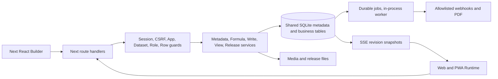

# ความสามารถปัจจุบันของ App Builder

ตรวจเมื่อ **29 ตุลาคม 2026 (Asia/Bangkok)** — source/config research เท่านั้น ไม่เปิดข้อมูลจริง/secrets ไม่รัน runtime หรือ tests ใหม่

## ขอบเขต

Repository ที่มีจริง: C:/xampp/htdocs/App-Builder (path เดิมใน environment ไม่มีอยู่). รวม uncommitted working tree ปัจจุบัน. สำรวจ inventory/import/export ของ **554 ไฟล์**: app188/lib128/scripts7/tests219/public1/deploy2/root-config9; พบ **50 API routes,25 pages,84 TSX components**. [Inventory+hash](evidence/source-inventory.json), [schema จาก source](evidence/schema-inventory.json). อ่าน implementation หลักและจุดเชื่อมตาม 15 โมดูล; inventory ทั้งระบบไม่ใช่รับรองว่าอ่านทุกบรรทัดหรือ runtime ทุกฟีเจอร์ผ่านแล้ว

ไม่เปิด .env/live DB/WAL/uploads/backups/private releases/artifacts/node_modules. Implemented=พบ code path เชื่อมกัน; Partial=ขอบเขตยังไม่ครบ; Missing=ไม่พบใน source/config/deps ไม่ใช่ตัดสิน deployment ภายนอก; Unknown=หลักฐานไม่พอ. ผล runtime เดิมอยู่ใน [audit repair](../../audits/2026-10-29-confirmed-fixes/RESULTS.md) ไม่ได้รันซ้ำรอบนี้

## Current architecture

- Modular monolith ขอบเขต module ยังไม่สม่ำเสมอ: Next14/React18/Node/better-sqlite3; ยังไม่มีเหตุผลให้แยก microservices ทั้งระบบ
- Multi-app: catalog ผู้ใช้/ตารางร่วม, config tables แยก prefix และ AsyncLocalStorage; ไม่ใช่แยก database ต่อองค์กรครบรูปแบบ
- Write: permissions → editable/default/required/ref/unique/media validation → parent/child transaction → workflow events. [lib/data-write.ts:17](../../../lib/data-write.ts#L17)
- Binding: authorized data snapshot → scoped batches → browser evaluator. [app/components/useCustomBindings.ts:7](../../../app/components/useCustomBindings.ts#L7)
- Publish: draft DB + review hash + metadata transaction; structural schema ต้องตรง baseline. [lib/releases.ts:31](../../../lib/releases.ts#L31)

## Module coverage

| Area | Inventory IDs | ตรวจ source/interaction | Runtime รอบนี้ |
|---|---|---|---|
| Frontend | C01,C12–17 | layout/runtime renderer/designer/CSS | Not Tested |
| Backend | C02,C25–30 | withAuth/writeRecord/services | Not Tested |
| Database | C03–06,C23–24 | schema/db/app scope | Not Tested |
| Builder Engine | C04,C12,C15,C36 | metadata/views/releases | Not Tested |
| UI Components | C14–16 | 84 TSX components | Not Tested |
| Data Binding | C17–19 | bindings/AST/context | Not Tested |
| Dynamic Form | C20–22,C35 | RuntimeTable/columns/PartOfForms | Not Tested |
| Layout/Page Builder | C15–16 | custom-page/designer/runtime | Not Tested |
| Actions/Events | C25–27 | action-config/automation | Not Tested |
| Auth/Permissions | C07–11 | auth/row-access/roles | Not Tested |
| Integrations/API | C30–32 | routes/webhooks | Not Tested |
| Publishing/Runtime | C12,C34–38,C46 | releases/PWA/Docker | Not Tested |
| Plugins/Extensions | C43 | fixed union/dependency search | Not Tested |
| AI Features | C19,C44 | source/provider search | Not Tested |
| Workflow | C26–28 | workflow config/worker/PDF | Not Tested |

Status totals (static): Implemented 33, Partial 7, Missing 6, Unknown 1. ทั้งหมดไม่ใช่ runtime pass count

## Feature inventory

| ID / Feature | Status | Implementation | Related files | Quality / limitations | Extension opportunity |
|---|---|---|---|---|---|
| C01 Frontend / Builder | Implemented | Next App Router + React client editors; CSS global + feature CSS | [app/layout.tsx:1](../../../app/layout.tsx#L1) | ไม่มี UI package แยก; RuntimeTable ใหญ่และผูก state หลายหน้าที่ | C02/L01 แยก tokens และ contracts โดยไม่เขียนใหม่ |
| C02 Backend / APIs | Implemented | Route handlers + withAuth + library services; Node runtime | [lib/auth-api.ts:13](../../../lib/auth-api.ts#L13) | 50 API routes; service boundary ยังอาศัย globals/context และ raw SQL | ย้าย orchestration เป็น service interfaces ทีละโมดูล |
| C03 Database / migrations | Implemented | better-sqlite3; lazy connection; schema initialization/rebuild | [lib/db.ts:33](../../../lib/db.ts#L33) | SQLite sync ใน process; migrations ฝัง initializer ไม่มี journal migration เป็นชุด | B01/B02; อย่าย้าย DB เพียงเพราะจำนวนแถว |
| C04 Metadata app engine | Implemented | _tables/_columns/_views/_actions + dynamic t_* data tables | [lib/schema.ts:33](../../../lib/schema.ts#L33) | Metadata และ business data ใช้ DB เดียวกัน; ไม่มี portable app-spec ครบชุด | A01 envelope + schema versions |
| C05 Multi-app + shared datasets | Implemented | AsyncLocalStorage app scope; prefixed config tables; shared grants | [lib/application-context.ts:13](../../../lib/application-context.ts#L13) | เป็น multi-app deployment ไม่ใช่ tenant isolation แยกองค์กรครบ; มีเพดาน 200 apps ใน schema helper | J02 หลังมีความต้องการองค์กรจริง |
| C06 App lifecycle | Implemented | สร้าง ลบ clone ด้วยข้อมูลชุดใหม่หรือ shared dataset | [lib/application-lifecycle.ts:1](../../../lib/application-lifecycle.ts#L1) | มี transaction และการตรวจ reference; ไม่ใช่ marketplace/template dependency resolver | A02 เพิ่ม package + remap + preview |
| C07 Per-app roles / Builder grants | Implemented | local roles/members/table CRUD/export/action/row rules | [lib/application-schema.ts:8](../../../lib/application-schema.ts#L8) | แยก Builder ออกจาก runtime user; Owner ยังเป็น central trust root | F01 อธิบาย effective rights + boundary tests |
| C08 Row-level access | Implemented | Server-side evaluator แยก read/create/update/delete | [lib/row-access.ts:30](../../../lib/row-access.ts#L30) | App-layer enforcement ไม่ใช่ DB-native RLS; Owner/Builder bypass row rules ตามโค้ด; ไม่อนุญาต cross-table rules | B01 compile subset; F01 simulation |
| C09 Field authorization | Partial | editable_if/validation ฝั่งเซิร์ฟเวอร์ + show_if ฝั่งแสดงผล | [lib/data-write.ts:7](../../../lib/data-write.ts#L7) | ไม่พบ policy read/mask ราย field ที่ครอบคลุม API/Excel/PDF; Show_If ไม่ใช่ security | F01 เพิ่ม field visibility/projection policy |
| C10 Login / sessions / CSRF | Implemented | username/email, scrypt, server sessions, expiry/idle, same-origin writes | [lib/auth.ts:7](../../../lib/auth.ts#L7) | AUD-002 Login aggregate limit ยังพัก; รหัสผ่านขั้นต่ำ 4 ตาม product policy | F02 identity federation หลังเปิดอนุมัติ hardening |
| C11 SSO / MFA / service tokens | Missing | ไม่พบ OIDC/SAML/TOTP/service-token implementation ใน source/deps ที่สำรวจ | [lib/auth.ts:1](../../../lib/auth.ts#L1) | Missing หมายถึงไม่พบใน repo snapshot; ไม่ได้ตรวจ identity proxy ภายนอก | F02/F03 แบบ optional |
| C12 Nine runtime view kinds | Implemented | custom/table/list/detail/form/map/chart/calendar/dashboard | [lib/views.ts:3](../../../lib/views.ts#L3) | แสดงหลายรูปแบบแล้ว; ยังไม่มี Kanban เป็น kind | C03 เลือก use case ก่อนเพิ่ม |
| C13 Filters / chips / nested groups | Implemented | quick filters, tab counts/radius, group navigation, nested grouping | [lib/view-filter-config.ts:1](../../../lib/view-filter-config.ts#L1) | มีของจริงและ regression; ไม่เสนอสร้าง filters ใหม่ | ปรับ saved personal views และ query delegation แทน |
| C14 Theme / navigation / profile | Implemented | dark mode, header, desktop/mobile nav, avatars, profile | [app/components/NavigationBar.tsx:1](../../../app/components/NavigationBar.tsx#L1) | config หลายหน้าบางส่วนใช้ CSS เดียว; a11y/responsive tokens ยังไม่มี contract กลาง | C02 ขยายของเดิม |
| C15 Visual custom page designer | Implemented | tree/layout, drag/move, inspector, bindings, View/form embedding | [lib/custom-page.ts:1](../../../lib/custom-page.ts#L1) | 11 node types; 100 nodes/8 levels/80k JSON; version 1/2; ไม่ใช่ arbitrary React editor | C01/L01 reuse registry ก่อนเพิ่ม widgets |
| C16 Reusable component packages | Missing | มี React components ใช้ภายใน แต่ไม่พบ maker-defined cross-app component library | [lib/custom-page.ts:1](../../../lib/custom-page.ts#L1) | แยก reuse ใน source ออกจาก reuse ที่ผู้สร้างแอปจัดการเอง | C01 component definitions + pinned versions |
| C17 Custom data binding | Implemented | valueExpr/showIf/disabledIf/rowExpr/defaults; scoped request batching | [app/components/useCustomBindings.ts:7](../../../app/components/useCustomBindings.ts#L7) | shared expression endpoint; refresh coarse; snapshot query มีขอบเขต | B01 query plan และ K02 inspector |
| C18 Formula engine | Implemented | bounded AST parser/interpreter browser+server, refs, dates, duration, distance, ORDERBY | [lib/expression.ts:15](../../../lib/expression.ts#L15) | ไม่รัน user JS; ไม่ใช่ Power Fx เต็มภาษา; SELECT snapshot มีเพดาน ไม่ใช่ remote delegation | H01 ต่อ API assistant เข้าตัวตรวจเดิม |
| C19 Formula help / debugging | Implemented | autocomplete/highlight/examples, expression tester, readiness | [app/components/ExpressionAssistant.tsx:10](../../../app/components/ExpressionAssistant.tsx#L10) | Assistant เป็น deterministic editor ไม่ใช่ LLM; ไม่มี provider config/AI API | H01; ไม่ตั้งชื่อของเดิมว่า AI |
| C20 Dynamic fields / forms | Implemented | typed metadata, defaults, virtual, valid/show/required/editable, reset | [lib/columns.ts:10](../../../lib/columns.ts#L10) | มีชนิดข้อมูล time/user/price/rating ฯลฯ; ไม่พบ wizard schema หรือ autosave drafts | D01/D02 ต่อยอด save path เดิม |
| C21 Related parent/child forms | Implemented | inline/ref auto-add, linked defaults, required children, atomic groups | [lib/part-of-records.ts:1](../../../lib/part-of-records.ts#L1) | write depth 8; ไม่ใช่ arbitrary disconnected graph form | D01 step validation ต้องเคารพ parent/child transaction |
| C22 Media / capture | Implemented | images/files/signatures/GPS/barcode + gallery settings | [lib/barcode.ts:1](../../../lib/barcode.ts#L1) | browser permission/HTTPS/device constraints; no offline upload queue | I03 ต้องมี blob budget ไม่ใช่แค่ queue JSON |
| C23 Data schema diagram | Implemented | Ref/list/enum relation edges + drag/zoom/search | [lib/schema-diagram.ts:6](../../../lib/schema-diagram.ts#L6) | เป็น visual inspection + links; ไม่ใช่ ER editor ที่สร้าง FK/constraints จากลากเส้น | B03 ต่อ inspector เดิม |
| C24 Reference / delete integrity | Implemented | Ref FK + cascade configuration + dependency checks | [lib/delete-record.ts:1](../../../lib/delete-record.ts#L1) | business delete orchestration ต้องคง permission checks; bulk scale ต้องทดสอบ | A03 change impact graph |
| C25 Actions / events | Implemented | 14 action kinds, grouped actions, snapshot/sequential set, form saved action | [lib/action-config.ts:2](../../../lib/action-config.ts#L2) | registry เป็น object/union hard-coded; ไม่ใช่ extension SDK | E01/L01 workflow action contracts |
| C26 Workflow engine | Implemented | manual/create/update/delete/schedule; set actions/PDF/outbound webhook; job status/checkpoints | [lib/workflow-config.ts:4](../../../lib/workflow-config.ts#L4) | 3 step kinds, 1–10 steps; schedule scan 10k rows/match 500; no wait/approval/branch types | E01/E02/E03 |
| C27 Workers / retries | Partial | transactional job enqueue, checkpoints/resume, stable Idempotency-Key (job+step), manual confirmed retry | [lib/workflow-runner.ts:46](../../../lib/workflow-runner.ts#L46) | มี timeoutunknownoutcome warning แล้ว; ยังขาด per-deliveryreceipts/structuredunknownstate/boundedautomaticretrypolicy/lease | E03 outbox/receiver idempotency; worker แยกเฉพาะจำเป็น |
| C28 PDF generation | Implemented | visual template, related table, Thai fonts, signature/images, file output | [lib/pdf-report.ts:20](../../../lib/pdf-report.ts#L20) | Playwright/browser resource cost; AUD-007 query optimization มีแล้ว | เพิ่ม budget/queue ไม่สร้าง PDF engine ซ้ำ |
| C29 Excel import/export | Implemented | Excel permissions/ids-labels-both/selected columns; header name-label matching, preview rollback, issues, atomic <=5000 rows | [app/components/ExcelTransfer.tsx:1](../../../app/components/ExcelTransfer.tsx#L1) | มี preview/validation แล้ว; โอกาสเพิ่ม explicitcustommapping, durablestaging/status และ boundedlargejobs | D03 เพิ่ม staged validation |
| C30 REST integration | Partial | session-protected internal APIs + outbound webhook payload/response mappings | [lib/workflow-config.ts:4](../../../lib/workflow-config.ts#L4) | ไม่พบ generic REST resource/query builder, external DB adapter, scoped public API token, OpenAPI contract | G01/G02/G03/F03 |
| C31 GraphQL | Missing | ไม่พบ schema/resolver/server/client datasource adapter ใน source/deps | [package.json:1](../../../package.json#L1) | ไม่จำเป็นต้องเพิ่ม endpoint เพื่อเลียนแบบคู่แข่ง | ทำ REST adapter ก่อน; GraphQL เมื่อมี consumer จริง |
| C32 Realtime | Implemented | per-table revision triggers + SSE snapshots/revalidation | [app/api/realtime/route.ts:14](../../../app/api/realtime/route.ts#L14) | poll DB 1s ต่อ stream; ส่ง revision ไม่ใช่ row delta; ไม่ใช่ collaborative builder editing | I02 fanout/backpressure หลังวัดโหลด |
| C33 Runtime caching | Implemented | dedup/cache/read snapshots + bounded IndexedDB | [lib/runtime-storage.ts:2](../../../lib/runtime-storage.ts#L2) | 100 read entries, 250k JSON cap; cache ไม่เท่ากับ offline-first writes | I03 แยก phase read/write |
| C34 PWA per app | Implemented | manifest/scope/install/icons/update guard/offline explanation | [lib/pwa-worker.ts:6](../../../lib/pwa-worker.ts#L6) | SW ไม่ cache authenticated HTML/API/media/writes; offline shell ไม่ใช่ offline CRUD | I03 optional หลัง version/idempotency |
| C35 Optimistic editing | Partial | row hash + 409 stale protection when __version supplied | [lib/row-version.ts:6](../../../lib/row-version.ts#L6) | optional token; ไม่มี field merge UI/all-client enforcement | D02/I03 ต้องกำหนด mandatory contract เฉพาะ API รุ่นใหม่ |
| C36 Draft / publish / rollback | Partial | isolated DB drafts, metadata diff, baseline hash, publish/rollback | [lib/releases.ts:31](../../../lib/releases.ts#L31) | structural hash ต้องเท่ากัน; publish ได้เฉพาะ config/formulas ไม่ใช่ schema migrations; จำกัด draft10 | A01/J01 schema migration plan + environment bindings |
| C37 Git / environment promotion | Missing | ไม่พบ remote Git transport หรือ dev/stage/prod config resource binding | [lib/releases.ts:1](../../../lib/releases.ts#L1) | อย่าเรียกว่าไม่มี versioning; ของเดิมเป็น local release engine | J01 เพิ่ม portable release pipeline |
| C38 Backup / restore per app | Implemented | backup plans, isolated stage, account mapping, new-app restore | [lib/application-backups.ts:14](../../../lib/application-backups.ts#L14) | มี already; ไม่ใช่ point-in-time continuous recovery/SLA proof | เพิ่ม scheduled restore drills ตามนโยบาย ไม่สร้าง backup ใหม่ |
| C39 File management / usage logs | Implemented | media catalog/references/cleanup + per-app user activity | [lib/media-inventory.ts:18](../../../lib/media-inventory.ts#L18) | reference scan cost; logs/PII retention ต้องมี policy | J03 budgets/redaction |
| C40 Audit / observability | Partial | audit log, app/table request metrics, RAM/DB size reports, formula timings | [lib/system-metrics.ts:11](../../../lib/system-metrics.ts#L11) | process-local aggregates; ไม่มี distributed spans/SLO notifications/export pipeline | J03/K02 ต่อของเดิม |
| C41 Readiness / simulation | Implemented | health rules, sample rows, dry-run Action/workflow trace | [lib/simulation.ts:1](../../../lib/simulation.ts#L1) | มี validation/debugging แล้ว; ไม่พบ maker-defined reusable test suites | K01 tests-as-metadata |
| C42 QA / regression tooling | Implemented | Node unit + isolated API/Playwright suites, production build gates | [scripts/integration.cjs:6](../../../scripts/integration.cjs#L6) | 219 test files inventory ไม่เท่ากับ 219 tests passed; prior repair330unit/15API ไม่ใช่ rerun ครั้งนี้ | K01 ใช้ infrastructure เดิม |
| C43 Plugin ecosystem | Missing | fixed node/action/view unions; no manifest install/capability/lifecycle service | [lib/custom-page.ts:1](../../../lib/custom-page.ts#L1) | React imports เป็น internal components ไม่ใช่ permission-isolated plugins | L01 registry internal ก่อน L02 trusted plugins |
| C44 AI generation / assistance | Missing | no LLM provider route/dependency/config found by whole-source search | [package.json:1](../../../package.json#L1) | formula helper ไม่ใช่ AI; external developer tools ไม่ใช่ product feature | H01 then H02/H03 แบบ draft-only |
| C45 Builder collaboration | Partial | multiple accounts/Builder grants; draft conflict hashes | [lib/releases.ts:36](../../../lib/releases.ts#L36) | ไม่พบ presence, locks by editor session, CRDT หรือ semantic merges | J01 role review ก่อน live multiplayer |
| C46 Deployment | Implemented | Docker Compose + Caddy overlay, health routes, single-process app | [Dockerfile:1](../../../Dockerfile#L1) | configuration มีแล้ว; ไม่ยืนยัน VPS ตั้งค่า/alert จริง; ยังมี security advisories พัก | hardening gate ก่อน external exposure |
| C47 Production UX / adoption | Unknown | มี user feedback ในบทสนทนาแต่ไม่มี anonymized task-study/analytics baseline ใน repo | [docs/RUNTIME_AUDIT_2026-10-27.md:1](../../../docs/RUNTIME_AUDIT_2026-10-27.md#L1) | ไม่มีการสัมภาษณ์หรือ competitor hands-on ใน research รอบนี้ | ทดสอบ 5 makers/5 end users ก่อนยืนยันคะแนน RICE |

## API inventory

Internal session-authenticated APIs; ไม่พบ public stable version/OpenAPI. นับจาก source exports ไม่ใช่ runtime probes

| Source | HTTP methods |
|---|---|
| [app/api/actions/route.ts:1](../../../app/api/actions/route.ts#L1) | GET, POST, PUT, DELETE |
| [app/api/app-activity/route.ts:1](../../../app/api/app-activity/route.ts#L1) | POST |
| [app/api/app-icon/route.ts:1](../../../app/api/app-icon/route.ts#L1) | GET |
| [app/api/app-management/route.ts:1](../../../app/api/app-management/route.ts#L1) | GET, DELETE |
| [app/api/application-access/route.ts:1](../../../app/api/application-access/route.ts#L1) | GET |
| [app/api/applications/route.ts:1](../../../app/api/applications/route.ts#L1) | GET, POST, PUT, DELETE |
| [app/api/audit-log/route.ts:1](../../../app/api/audit-log/route.ts#L1) | GET |
| [app/api/auth/login/route.ts:1](../../../app/api/auth/login/route.ts#L1) | POST |
| [app/api/auth/logout/route.ts:1](../../../app/api/auth/logout/route.ts#L1) | POST |
| [app/api/auth/profile/route.ts:1](../../../app/api/auth/profile/route.ts#L1) | GET, PATCH |
| [app/api/auth/session/route.ts:1](../../../app/api/auth/session/route.ts#L1) | GET |
| [app/api/auth/setup/route.ts:1](../../../app/api/auth/setup/route.ts#L1) | POST |
| [app/api/backups/[name]/route.ts:1](../../../app/api/backups/[name]/route.ts#L1) | GET |
| [app/api/backups/application/route.ts:1](../../../app/api/backups/application/route.ts#L1) | GET, POST |
| [app/api/backups/restore/route.ts:1](../../../app/api/backups/restore/route.ts#L1) | POST, DELETE |
| [app/api/backups/route.ts:1](../../../app/api/backups/route.ts#L1) | GET, POST |
| [app/api/branding/route.ts:1](../../../app/api/branding/route.ts#L1) | GET |
| [app/api/data/[table]/clear/route.ts:1](../../../app/api/data/[table]/clear/route.ts#L1) | POST |
| [app/api/data/[table]/route.ts:1](../../../app/api/data/[table]/route.ts#L1) | GET, POST, PUT, DELETE |
| [app/api/data/[table]/validate/route.ts:1](../../../app/api/data/[table]/validate/route.ts#L1) | POST |
| [app/api/excel/[table]/route.ts:1](../../../app/api/excel/[table]/route.ts#L1) | GET, POST |
| [app/api/expression-data/route.ts:1](../../../app/api/expression-data/route.ts#L1) | GET, POST |
| [app/api/field-users/route.ts:1](../../../app/api/field-users/route.ts#L1) | GET |
| [app/api/files/[id]/route.ts:1](../../../app/api/files/[id]/route.ts#L1) | GET |
| [app/api/files/route.ts:1](../../../app/api/files/route.ts#L1) | POST |
| [app/api/health/route.ts:1](../../../app/api/health/route.ts#L1) | GET |
| [app/api/images/[id]/route.ts:1](../../../app/api/images/[id]/route.ts#L1) | GET |
| [app/api/images/route.ts:1](../../../app/api/images/route.ts#L1) | POST |
| [app/api/lists/[table]/route.ts:1](../../../app/api/lists/[table]/route.ts#L1) | GET, POST |
| [app/api/pdf-templates/route.ts:1](../../../app/api/pdf-templates/route.ts#L1) | GET, POST, PUT, DELETE |
| [app/api/performance/route.ts:1](../../../app/api/performance/route.ts#L1) | GET |
| [app/api/readiness/route.ts:1](../../../app/api/readiness/route.ts#L1) | GET, POST |
| [app/api/realtime/route.ts:1](../../../app/api/realtime/route.ts#L1) | GET |
| [app/api/releases/route.ts:1](../../../app/api/releases/route.ts#L1) | GET, POST |
| [app/api/scan/[table]/route.ts:1](../../../app/api/scan/[table]/route.ts#L1) | POST |
| [app/api/settings/route.ts:1](../../../app/api/settings/route.ts#L1) | GET, PUT |
| [app/api/slices/route.ts:1](../../../app/api/slices/route.ts#L1) | GET, POST, PUT, DELETE |
| [app/api/system-report/route.ts:1](../../../app/api/system-report/route.ts#L1) | GET |
| [app/api/tables/[name]/convert/route.ts:1](../../../app/api/tables/[name]/convert/route.ts#L1) | POST, PUT, DELETE |
| [app/api/tables/[name]/duplicates/route.ts:1](../../../app/api/tables/[name]/duplicates/route.ts#L1) | GET |
| [app/api/tables/[name]/raw/route.ts:1](../../../app/api/tables/[name]/raw/route.ts#L1) | GET |
| [app/api/tables/[name]/route.ts:1](../../../app/api/tables/[name]/route.ts#L1) | PATCH, DELETE |
| [app/api/tables/route.ts:1](../../../app/api/tables/route.ts#L1) | GET, POST |
| [app/api/user-settings/route.ts:1](../../../app/api/user-settings/route.ts#L1) | GET, PUT, POST |
| [app/api/users/route.ts:1](../../../app/api/users/route.ts#L1) | GET, POST |
| [app/api/view-data/[table]/route.ts:1](../../../app/api/view-data/[table]/route.ts#L1) | GET |
| [app/api/views/preview/route.ts:1](../../../app/api/views/preview/route.ts#L1) | POST |
| [app/api/views/route.ts:1](../../../app/api/views/route.ts#L1) |  |
| [app/api/workflows/files/[id]/route.ts:1](../../../app/api/workflows/files/[id]/route.ts#L1) | GET |
| [app/api/workflows/route.ts:1](../../../app/api/workflows/route.ts#L1) | GET, POST, PUT, DELETE |

## ข้อจำกัด

ไม่มี interviews/task study หรือ competitor hands-on ในรอบนี้; UX/impact เป็นสมมติฐานต้องพิสูจน์. Tests219 ไฟล์ไม่เท่ากับ 219tests ผ่าน. ล้านแถว/หลาย worker/หลาย tenant ยังไม่พิสูจน์ ต้องวัดตาม query และ permission workload

AUD-002/AUD-003 ยังพักตามคำสั่งผู้ใช้; research ไม่เปิดงาน Login/framework upgrade กลับมาเอง. Roadmap ไม่ใช่อนุมัติ deployment

## Implementation nuance: ไม่เสนอของเดิมซ้ำ

Workflow มี transactionaljobenqueue และ stableIdempotency-Key อยู่แล้ว ดู [lib/workflows.ts](../../../lib/workflows.ts#L23), [lib/workflow-runner.ts](../../../lib/workflow-runner.ts#L32), และ manualconfirmedretry ใน [API](../../../app/api/workflows/route.ts). E03 จึงเพิ่ม deliveryreceipt/structuredunknownoutcome/recoverypolicy ไม่ใช่เพิ่ม header หรือ queue เป็นครั้งแรก. Excel มี dry-runpreview/rollback/validation/headersmatching และ 5000-rowbound ใน [importExcel](../../../lib/excel.ts#L68); D03 ต่อยอด custommapping+durablestaging ไม่สร้าง preview ใหม่แทนของเดิม
