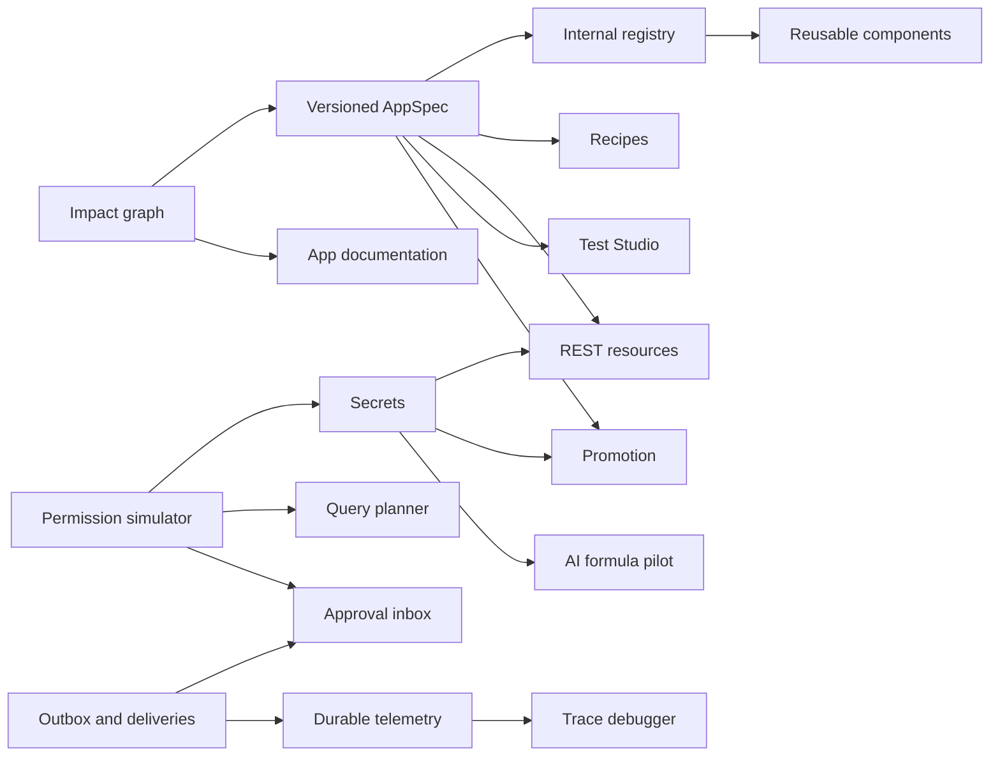

# Feature Roadmap / Prioritization

จัดทำ 2026-10-29. เป็น proposedimplementationroadmap ไม่ใช่อนุมัติเขียน code/deploy. AUD-002/AUD-003 ยังพักและไม่มีการแทรกกลับเข้ารอบแก้ไข

## Product goal and constraints

โฟกัสให้ businessmaker สร้าง internalWeb/PWA/businessworkflow จาก typedmetadata ได้เอง โดย reuse/security/performance ที่ตรวจได้ ก่อนแข่งเป็น generalwebsite/native-codegenerator ทุกชนิด. ผู้ใช้เป้าหมายตั้งต้น: operationalteams3–10makers และ endusers20–200 ต่อ deployment (สมมติฐาน ไม่ใช่ usage จริง). ปีแรกให้พิสูจน์ 3workloads: ตรวจรถ, คำขออนุมัติ, inventorydashboard

## Weighted scoring (reproducible hypotheses)

ใช้ WeightedScoring แทน RICE เพราะยังไม่มี reach ตัวเลขจาก analytics จริง. UserValue30%, Reach20%, StrategicFit20%, RiskReduction20%, Feasibility10%; แต่ละตัว 1–5 แล้วคูณ 20 และ Confidence0–1. Score=20×(0.30V+0.20R+0.20S+0.20Risk+0.10F)×Confidence. Reach=ประมาณสัดส่วนกลุ่มเป้าหมาย ไม่ใช่จำนวนผู้ใช้; confidence=ความมั่นใจ problem-fit จาก source และ userhistory ไม่ใช่ probabilitybug

Feasibility1–5 สะท้อน effort/complexity/unknowns ไม่แปลงเป็น deliverypromise. Impact1–5 ใน backlog แยกจาก score. ควร re-score หลัง taskstudy โดยเฉพาะ AI/offline/collab ที่ยังไม่มี fielddata. ไม่ใช้ score ข้าม security/authorization/dependencygates

| Rank | ID / Feature | V | R | Fit | Risk reduction | Feasibility | Confidence | Score/100 | MVP pd | Priority |
|---|---|---:|---:|---:|---:|---:|---:|---:|---|---|
| 1 | A01 Versioned App Package & Migration Plan | 5 | 5 | 5 | 5 | 3 | 0.8 | 76.8 | 18–28 | P1 |
| 2 | F01 Effective Permission Simulator | 5 | 5 | 5 | 5 | 3 | 0.8 | 76.8 | 10–16 | P1 |
| 3 | E03 Workflow Delivery Ledger & Recovery Policies | 5 | 4 | 5 | 5 | 3 | 0.8 | 73.6 | 18–28 | P1 |
| 4 | G02 App-scoped Connection Secrets | 5 | 4 | 5 | 5 | 3 | 0.8 | 73.6 | 14–22 | P1 |
| 5 | B01 Permission-aware Query Planner & Delegation | 5 | 5 | 5 | 5 | 2 | 0.75 | 70.5 | 25–40 | P1 |
| 6 | A03 Cross-app Dependency & Change Impact Explorer | 4 | 4 | 5 | 5 | 4 | 0.8 | 70.4 | 8–14 | P1 |
| 7 | L01 Internal Component / Action Registry | 5 | 4 | 5 | 4 | 3 | 0.8 | 70.4 | 16–26 | P1 |
| 8 | J03 Durable Observability / SLO & Alerts | 5 | 4 | 5 | 5 | 3 | 0.75 | 69 | 14–24 | P1 |
| 9 | E02 Human Approval Inbox / Durable Wait | 5 | 4 | 5 | 5 | 2 | 0.75 | 67.5 | 25–40 | P1 |
| 10 | G01 REST Data Source & Query Builder | 5 | 4 | 5 | 5 | 2 | 0.75 | 67.5 | 22–34 | P1 |
| 11 | J01 Environment Promotion & Review Workflow | 5 | 4 | 5 | 5 | 2 | 0.75 | 67.5 | 25–40 | P1 |
| 12 | C01 Reusable Visual Components | 5 | 4 | 5 | 4 | 3 | 0.75 | 66 | 18–28 | P1 |
| 13 | K01 No-code Test Studio & Publish Gates | 5 | 4 | 5 | 5 | 3 | 0.7 | 64.4 | 18–28 | P1 |
| 14 | K03 Living App Documentation Generator | 4 | 4 | 4 | 3 | 5 | 0.8 | 62.4 | 4–7 | P1 |
| 15 | A02 Business App Recipes / Template Installer | 5 | 4 | 5 | 3 | 4 | 0.7 | 60.2 | 12–18 | P1 |
| 16 | D02 Recoverable Form Drafts & Conflict Review | 5 | 4 | 4 | 4 | 3 | 0.7 | 58.8 | 14–22 | P1 |
| 17 | K02 Binding / Workflow Trace Debugger | 4 | 4 | 4 | 4 | 3 | 0.75 | 58.5 | 10–18 | P2 |
| 18 | G03 Signed Inbound Webhooks | 4 | 3 | 5 | 5 | 3 | 0.7 | 57.4 | 14–22 | P2 |
| 19 | E01 Bounded Workflow Branches & Iteration | 5 | 4 | 5 | 4 | 2 | 0.65 | 55.9 | 25–40 | P2 |
| 20 | C02 Responsive Tokens & Accessibility Inspector | 4 | 5 | 4 | 3 | 3 | 0.7 | 54.6 | 10–16 | P1 |
| 21 | B02 Index Advisor & Explain Console | 4 | 3 | 4 | 4 | 4 | 0.7 | 53.2 | 8–14 | P2 |
| 22 | H01 AI Formula Assistant (Thai-first) | 5 | 4 | 5 | 4 | 3 | 0.6 | 52.8 | 12–20 | P1 |
| 23 | F03 Scoped Service Accounts & Stable API v1 | 4 | 3 | 5 | 5 | 2 | 0.65 | 52 | 20–32 | P2 |
| 24 | B03 Relationship / Constraint Designer | 4 | 3 | 4 | 5 | 3 | 0.65 | 50.7 | 16–26 | P2 |
| 25 | F02 OIDC Federation & Step-up MFA | 4 | 3 | 4 | 5 | 2 | 0.65 | 49.4 | 25–40 | P2 |
| 26 | I01 Virtualized Runtime Tables / Lists | 4 | 4 | 4 | 2 | 3 | 0.7 | 49 | 12–20 | P2 |
| 27 | D03 Staged Import Mapping & Validation | 4 | 3 | 4 | 4 | 3 | 0.65 | 48.1 | 18–28 | P2 |
| 28 | D01 Multi-step / Wizard Forms | 4 | 4 | 3 | 2 | 3 | 0.7 | 46.2 | 10–16 | P2 |
| 29 | H02 AI Schema Planner | 4 | 4 | 5 | 4 | 3 | 0.55 | 45.1 | 18–28 | P2 |
| 30 | I02 Realtime Fanout / Delta Invalidation | 4 | 3 | 4 | 4 | 2 | 0.6 | 43.2 | 20–32 | P2 |
| 31 | H03 AI Incremental App / UI / Workflow Drafts | 5 | 4 | 5 | 4 | 1 | 0.5 | 42 | 30–50 | P2 |
| 32 | I03 Offline Write Queue & Conflict Center | 5 | 3 | 4 | 5 | 1 | 0.5 | 40 | 40–65 | P3 |
| 33 | C03 Kanban View | 4 | 3 | 4 | 2 | 3 | 0.6 | 39.6 | 12–20 | P2 |
| 34 | L03 Private Package Catalog & Upgrade Planner | 4 | 2 | 5 | 4 | 2 | 0.55 | 39.6 | 18–30 | P3 |
| 35 | L02 Trusted Private Plugin SDK | 4 | 2 | 5 | 5 | 1 | 0.5 | 37 | 30–50 | P3 |
| 36 | J02 Organization Workspaces / Tenant Quotas | 4 | 2 | 5 | 5 | 1 | 0.4 | 29.6 | 50–80 | P3 |

เช่น A01=20×(1.5+1+1+1+0.3)×0.8=76.8. Score ของ A01/F01 เท่ากันจึงเลือก parallel ตามทีม/risks. [InputsJSON](evidence/feature-backlog.json). เปลี่ยน weight หรือ confidence±0.15 อาจสลับอันดับกลาง; foundationE03/G02/L01 ที่คะแนนสูงเป็น supportingwork แม้ Top10 หน้าผู้ใช้จะเน้นผลลัพธ์ product มากกว่า

## Buckets

| Bucket | Candidates | Decision |
|---|---|---|
| Quick Wins | K03 หลัง A03, F01MVPread-only, A03MVPimpact | เริ่มเล็กแต่ใช้ validator/guards เดียวกับ runtime; F01 ไม่แอบเปลี่ยนนโยบายสิทธิ์ |
| High Impact | B01,G01,E02,D02,J03 | แก้ scale/integration/businessprocess/lostinput โดยวัด baseline |
| Strategic | A01,L01,C01,A02,K01,J01,H01 | ทำ platformreuse และ safegeneration; AI หลัง contracts พร้อม |
| Long-term | I03,J02,L02,L03,H02/H03,F02/F03,E01full | ทำตาม customerneed/capabilitygates; firstyear บางเรื่องแค่ spike |
| Not Recommended now | arbitraryuntrustedJS/npm, autoprodAI, wholeplatformmicroservices, rewriteformula เป็น PowerFx ทันที, publicpluginstore, fullCRDT ก่อน need, DBmigration เพียงเพราะล้าน rows | ต้นทุน/security/maintenance ไม่สมเหตุผลกับหลักฐานปัจจุบัน |

## Capacity assumptions

ทีม 2fullstack +0.5QA +0.2UX/product =2.7FTE; 20workdays/month; featureallocation65% (35%บำรุงรักษา/bugs/support/review). Capacity≈35person-days/month รวม QA/UX: 35/70/105/210pd ใน 4 ช่วง รวม 420pd/ปี. ถ้าทำคนเดียว featurecapacity≈13pd/month ให้ขยาย calendar ประมาณ 2.7 เท่าหรือลด scope

Backlog36 ข้อรวม **659–1,062pd** จึงไม่ promise ทั้งหมดเสร็จในปี. Roadmap เลือก MVPsubset ด้วย pointplan ภายในช่วง estimate ไม่ถือว่าช่วงบนหายไป. ถ้ารวม unknowns เพิ่ม 30–50% ให้ dropP2/spikes หรือเลื่อน calendar ก่อนลด security/tests. ตัวเลขนี้ไม่ใช่ quote ผูกพัน

## Dependency order

A03 ก่อน A01 ใน calendar เพื่อทำ refinventory; A01MVP ไม่ต้องรอ UIimpact เต็มรุ่น. Dependencies ครบทุกบัตรใน Backlog/JSON; diagram นี้ย่อเฉพาะแกน. Phase เดียวกันต้องทำ prerequisite ให้เสร็จก่อน dependent

## 0–30 Days — budget 35pd

| Work | Plan pd | Definition of done / partial scope |
|---|---:|---|
| F01 Effective Permission Simulator | 12 | MVP complete |
| A03 Cross-app Dependency & Change Impact Explorer | 9 | MVP complete |
| K03 Living App Documentation Generator | 5 | MVP complete after A03 |
| A01 Versioned App Package & Migration Plan | 6 | Spec/mapping spike only; NOT complete |
| UX_RESEARCH  | 3 | 5makers+5endusers task study / baseline |

รวม 35pd. Acceptance ที่เป็น MVPcomplete ใช้บัตร Backlog ไม่ใช่แค่ UI ขึ้นได้

## 31–90 Days — budget 70pd

| Work | Plan pd | Definition of done / partial scope |
|---|---:|---|
| A01 Versioned App Package & Migration Plan | 18 | Finish MVP; total24pd including earlier6 |
| E03 Workflow Delivery Ledger & Recovery Policies | 22 | MVP complete |
| G02 App-scoped Connection Secrets | 18 | MVP complete after F01 |
| L01 Internal Component / Action Registry | 8 | Registry spike only; NOT complete |
| A02 Business App Recipes / Template Installer | 4 | Recipe spike only; NOT complete |

รวม 70pd. Acceptance ที่เป็น MVPcomplete ใช้บัตร Backlog ไม่ใช่แค่ UI ขึ้นได้

## 3–6 Months — budget 105pd

| Work | Plan pd | Definition of done / partial scope |
|---|---:|---|
| B01 Permission-aware Query Planner & Delegation | 32 | MVP complete |
| L01 Internal Component / Action Registry | 12 | Finish MVP; total20pd |
| C01 Reusable Visual Components | 22 | MVP complete after L01 |
| G01 REST Data Source & Query Builder | 26 | MVP complete after G02/A01/F01 |
| A02 Business App Recipes / Template Installer | 11 | Finish MVP; total15pd |
| VERIFY_BUFFER  | 2 | Performance/security baseline comparison |

รวม 105pd. Acceptance ที่เป็น MVPcomplete ใช้บัตร Backlog ไม่ใช่แค่ UI ขึ้นได้

## 6–12 Months — budget 210pd

| Work | Plan pd | Definition of done / partial scope |
|---|---:|---|
| E02 Human Approval Inbox / Durable Wait | 32 | MVP complete |
| K01 No-code Test Studio & Publish Gates | 22 | MVP complete |
| J01 Environment Promotion & Review Workflow | 32 | MVP complete |
| H01 AI Formula Assistant (Thai-first) | 16 | Closed pilot MVP complete; no auto publish |
| D02 Recoverable Form Drafts & Conflict Review | 18 | MVP complete |
| J03 Durable Observability / SLO & Alerts | 18 | MVP complete before K02 |
| C02 Responsive Tokens & Accessibility Inspector | 12 | MVP complete |
| D01 Multi-step / Wizard Forms | 12 | MVP complete |
| B02 Index Advisor & Explain Console | 10 | MVP complete after B01 |
| G03 Signed Inbound Webhooks | 18 | MVP complete |
| K02 Binding / Workflow Trace Debugger | 14 | MVP complete after J03 |
| E01 Bounded Workflow Branches & Iteration | 6 | Branch-IR spike only; NOT full workflow MVP |

รวม 210pd. Acceptance ที่เป็น MVPcomplete ใช้บัตร Backlog ไม่ใช่แค่ UI ขึ้นได้

## Release gates / measurement

| Gate | Evidence required |
|---|---|
| Baseline | syntheticfixture/querymix/roles/media ขนาดกำหนด; currentp50/p95/memory/errors; ห้ามใช้ข้อมูลจริงโดยไม่อนุญาต |
| Security | crossapp/dataset/fieldprojection/action/export/secret tests; unresolvedAUD-002/AUD-003 ต้อง explicitriskdecision ก่อน publiclaunch ไม่เปิดงานเอง |
| AppSpec/registry | oldmetadataandlayoutv1/v2roundtrip; unknownversionsreject; stagedmigration/rollback |
| Queryplanner | comparewithreferenceevaluator200cases; simplecount/pagingcorrect; unsupporteddelegationfailvisible |
| Workflow | crash/retry/duplicate/revocation/unknownoutcome; noexactly-onceclaimwithoutreceivercontract |
| UX | 5makers สร้าง recipe/form/query, 5endusers ทำงาน mobile; taskcompletion/error/timebaseline; realiPhonetest ก่อน promise |
| AI | >=80%semanticpass ใน 50goldencases และ negative/securitysuite; nosendingrowsbydefault; costcaps/humanreview |
| Restore | newisolatedinstanceverifyconfig/media/roles; no copyingcurrentaccountpasswords bypackage |
| Production | stagingHTTPS/reverseproxy/cookies/PWA/rollback; sourcechanges/DBmigration/deploy แยก approval |

Successhypotheses หลัง pilot: recipefirst-working-app<30min, repeatedformsaveconflict ไม่มี silentoverwrite, p95simple100k-rowread<500ms บน benchmarkhost ที่ประกาศ, UIlongtask ลด 30%ใน virtualizationpilot ถ้าเลือกทำ, MTTR ลดจาก baseline ผ่าน trace. เป้าหมายไม่ใช่ผลที่วัดได้แล้ว; hardware/concurrency/rowrule ต้องอยู่ใน report

## Explicitly deferred past initial year

I03fullmediaoffline+conflictresolution, J02shared-orgmultitenancy, L02untrustedruntimeextensions/L03publicstore, H03autonomousfullappbuilder, E01fullgeneralDAG, CRDTliveediting และ broadPostgreSQLmigration. จะทำ spike เฉพาะที่ budget ระบุ; ไม่เอา spike ไปอ้าง featurecomplete

ก่อนเริ่ม implementation เลือก batch แรก F01/A03/K03/A01spec และ approveacceptance/syntheticfixture. รอบ research นี้ยังไม่เขียน tests/productcode/ติดตั้ง dependency ใดๆ
