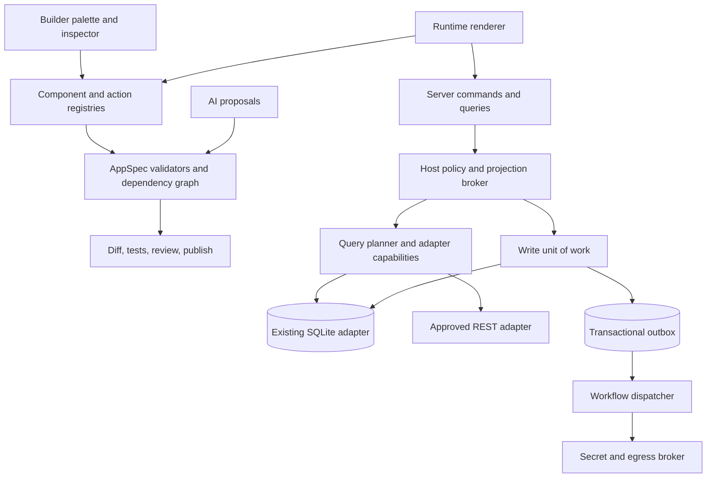

# Extension Architecture Proposal

วันที่ 2026-10-29 — Design proposal เท่านั้น ไม่ใช่ implementation. ดู [Current](CURRENT_SYSTEM_CAPABILITIES.md), [Backlog](FEATURE_IDEAS_BACKLOG.md) และ [Roadmap](FEATURE_ROADMAP.md)

## Decision: modular monolith + versioned contracts

คง Next/React/SQLite/metadata/expression/writeguards เดิม. ขอบเขต module ยังไม่สม่ำเสมอแต่ไม่พบเหตุผลให้แตก microservices ทั้งระบบ. แยก PDF/connector เป็น workerprocess/container เมื่อ metrics แสดงว่ากิน eventloop/RAM; เป็น deploymentrole ไม่จำเป็นต้องเปลี่ยนทุก service/DB

ปัจจุบัน CUSTOM_ELEMENTS/VIEW_KINDS/ACTION_KINDS/WORKFLOW_STEPS เป็น fixedlists/union ใช้เป็น seedregistry ได้ แต่ยังไม่มี pluginmanifest/installer/capabilitybroker/lifecycle. AsyncLocalStorage ช่วย scope แอปใน trustedcode ไม่ใช่ sandbox สำหรับ untrustedplugins

## Module placement

| Capability | Placement | Boundary / rationale |
|---|---|---|
| VersionedAppSpec, validation, permissions, registries | Core A01/F01/L01 | ทุก feature/AI ใช้ serialization/security เดียวกัน |
| QueryPlan, adaptercontracts, UnitOfWork/outbox | Core B01/E03 | centraltransaction/authorization ไม่ซ้ำหลาย implementation |
| Templates/components/wizard/Kanban | Optional A02/C01/D01/C03 | maker เลือกใช้โดยไม่ทำ core โตทุก usecase |
| REST/DBproviders/business-specificactions | First-party reviewed Plugin ผ่าน contracts | credentials/network/rowpolicies ต้องผ่าน hostbroker |
| OIDC/email/AI/objectstorage | External Integration | contracts รองรับ differentprovider/price/privacy |
| HeavyPDF/longconnector | Independent worker role เมื่อจำเป็น | resourcebudget/lease/retry; ไม่เริ่มด้วย service ใหม่ทันที |
| Organizationtenancy | Corelater J02 | กระทบทุก boundary; plugin ไม่ควรข้าม scope |
| Publicmarketplace/arbitrarycode | Defer | sandbox/supplychain/license/supportcost ยังสูง |

## Target interaction

## Extension API contracts

| Contract | Inputs / result | Invariants |
|---|---|---|
| ComponentRegistry | kind+version → configschema/editor/renderer/bindings/events/contexts | oneID/version; compatibleclient/server; noJSstrings |
| WorkflowActionRegistry | kind+version → input/outputschemas/validate/simulate/execute/sideeffectclass | simulate ไม่มี network; execute รับ scopedhostcontext; explicitretry/idempotency |
| DataSourceAdapter | describe/readPage/count/aggregate/mutateoptional + capabilities/typedQueryPlan | parameterbinding/cursor/timeout; rejectunsupported ไม่โหลดทั้งหมดเงียบๆ |
| PolicyDecision | actor/app/workspace/resource/operation/policyrevision → allow/deny/constraints/reason | derivecontextserver-side; defaultdeny; visibility ไม่ใช่ permission |
| SecretBroker | opaquecredentialref + actor/app/purpose → approvedoutboundoperation | no rawmasterkey/secrettoAI; redactedlogs; envbinding |
| UnitOfWork | trustedcommand + expectedversion/idempotencykey → receipt/events | DB+outboxatomic; network นอก DBtransaction |
| AppSpecCompiler | specversion/dependencylock/targetcapabilities → artifact/plan | stableIDs/completevisitors/hashboundapproval/noSQLuploads |
| EventTransport | versionedenvelope/outboxcursor → boundeddispatch | at-least-once+consumerdedupe; noexactly-onceclaim |
| ExtensionHost | approvedmanifest+grants → lifecycle/health/capabilityhandles | install ไม่ให้สิทธิ์เอง; grantintersectactor/app/resource/deployment |

### Versioned App Schema

AppSpecenvelope ควรมี formatVersion/appRevision/dataSchemaRevision/engineRange/componentVersions/dependencies. StableobjectIDs แยก name/label; refsresolve ผ่าน ID ก่อน compile กลับ metadata เดิม. Customlayoutversion1/2 เป็น subschema ไม่ใช่ whole-platformversion

เริ่มด้วย adapters ของ _tables/_columns และ per-appconfig ไม่ย้าย metadata ทุกอย่างเป็น JSONblob. Configmigrations เป็น puretransform; DDLplan แยก/review. Referencevisitor ต้องครอบคลุม formula/view/action/role/PDF/workflow/customnode/defaults และ A03 ตรวจ coverage. A01MVPconfig-only ไม่รัน SQL จาก package. J01MVPstructures ต้องตรงเหมือน releases เดิม; schema promotion ใช้ migrationplan ระยะถัดไป

Configurationrollback ไม่ย้อน businessrows หรือ externalwebhook ผลที่เกิดขึ้นแล้ว. Businessdatarecovery ต้องมี backup/compensationpolicy แยก ไม่ปุ่ม undo ที่หลอกว่าทุกอย่างย้อนกลับ

### Component Registry

- Wrapbuiltins ผ่าน descriptor ก่อน โดยเรียก validators/renderers เดิม: ลด rewrite และมี compatibilityadapter
- Lazyload เฉพาะ usedrenderers; ไม่โหลด map/PDFeditor ในทุกหน้า
- Makercomponent: definitionversion/typedprops/slots/events/bindingrefs/deviceconstraints. Instancespinversion และ reviewupgrade
- Events เรียก hostcommands; ไม่ให้ renderer ถือ DB/rawnetworkhandle
- Unknown/disabledcomponent แสดง safeplaceholder; ไม่ลบ data/ละ validator เพื่อ publish ผ่าน
- NewbuiltinMVP ควรเพิ่ม registration+contracttests โดยไม่ต้องกระจายแก้ switch หลายแห่ง

### Plugin Manifest / Dependency Management

Manifest ควรมี: reverse-domainID/version/publisher/licenseSPDX/integritydigest/manifestVersion/engineRange/kinds/configschema/dependencies/requestedcapabilities/migrationIDs/entrypointtype/resourcebudgets/networkorigins/supportalias. ห้าม credentialvalues. Signature ยืนยัน origin ไม่ได้ยืนยัน code ปลอดภัย

Resolverdetectcycles/conflicts, pintransitivedeps, verifyengineRange/registryversions/licenseinventory และ maintainerprovenance. Unknownversionfailclosed. Upgrade แสดง permissiondiff และต้อง grant ใหม่เฉพาะที่อนุมัติ ไม่ inheritnewprivileges อัตโนมัติ

MVP ใช้ first-partyreviewed/declarativepackages ไม่เปิด arbitrarynpminstall ใน runtime. ExternalUI ภายหลังต้อง iframe sandbox/CSP/typedpostMessage, strictorigin/sourcecheck, scopedMessagePort/token และไม่มี same-origin/session/DBaccess. Nodevm/WorkerThreads ไม่ใช่ securitysandbox สำหรับ untrustedcode. ถ้าต้องรัน servercode จากภายนอกใช้ separateprocess/container noenv/nohostmount/limitedegress พร้อม resourcebudget และ hostbroker; container อย่างเดียวไม่รับประกันปลอดภัย

### Data Source Adapter / Permission Boundary

RESTMVPread-only. Browser เลือก approvedresource ไม่ส่ง URL/token ตามใจ. Serverderiveactor/app/env → resourcegrant → resolvecredential → approvednetwork → query/predicate/projection → normalizedresult. Cursor/total/completeness ต้องชัด

Internalrowrule ไม่ติด remoteAPI อัตโนมัติ: ถ้า adapterenforcepredicate ก่อน paging/count ไม่ได้ ให้ rejectbinding หรือใช้ resource ที่ approved ว่า app-levelaccess เพียงพอ. ห้าม fetchall แล้ว UIfilter โดยอ้างเป็น RLS. Noquiettruncation ของ count/aggregate

Capabilities: serverFilter/serverSort/aggregate/stableCursor/optimisticWrite/transactionalBatch/changeFeed/rowPolicyDelegation. UI แสดง warning ตาม capability. RemoteAPI ที่ไม่มี atomicbatch ห้ามอ้างว่า parent-childsave เป็น transaction แบบ SQLite

SQLite เป็น baseline; PostgreSQLadapter ค่อยทำหลัง queryplanner/conformancesuite และมี writercontention/HArequirement จริง. Rowcount ล้านแถวอย่างเดียวไม่พอจะตัดสินใจ. ห้ามแชร์ SQLitewritevolume ข้าม hosts เพื่อ autoscale โดยไม่ออกแบบ storage/concurrency ใหม่

### Workflow Action Registry / Event Bus

ใช้ _automation_jobs และ actorreauth/checkpoint เดิม. E03reuse durablejobenqueue ที่อยู่ใน businesstransaction แล้วเป็น outboxadapter และเพิ่ม deliveryreceipt/attemptstate; dispatcherclaim แบบ lease/attempt. Envelope มี eventID/appID/actorprincipal/metadataRevision/table-row/type/version/idempotencykey/timestamps/traceID. Payloadproject ตาม consumerpurpose ไม่ broadcastrawrows

เริ่ม in-processdispatcher; workerrole แยกได้เมื่อวัดแล้ว. Backoff/jitter/maxattempt/deadletter; receiver ไม่มี idempotency ให้ markunknownoutcome และ reconcile ไม่ retryblindly. Checkpoint ไม่รับประกัน exactly-once

E02Wait/approval เก็บ durabletask/decisionversion/expiry; restart แล้วยังรอได้. Realtime เป็น consumer เพื่อ revisioninvalidation ก่อน rowdelta; subscriber ต้อง recheckpermission และ backpressure. BrowserCustomEvent เดิมกับ durablebusinessbus เป็นคนละ contract

## Plugin lifecycle

| Stage | Required gate | Failure / rollback |
|---|---|---|
| Discover | privatecatalog/license/source/version/integrity | rejectunapprovedcandidate |
| Stage | engine/schema/dependency/conformancetests | no livewrites; failedstage ไม่ install |
| Approve | requestedvsgrantedcapabilities; separateactorwherepolicyrequires | noautograntDB/network/secret |
| Install | atomicreceipt/configmigration; metadatabackup | DBtransactionrollback; externalcompensation เฉพาะที่ออกแบบ |
| Enable | app/envgrants/healthcheck/pinnedartifact | placeholder/disabledactions อย่างชัดเจน |
| Upgrade | dependencylockdiff/tests/review | retainlastknownworkingversion |
| Disable | stopnewjobs/revokehandles/inflightpolicy | no datadeletion; auditevent |
| Uninstall | dependentgraph; detach/exportfirst | rejectifused; cleanup ต้อง explicitretentionapproval |

## Logical persistence proposal

ใหม่ตาม feature ที่อนุมัติเท่านั้น ไม่สร้างทุก table ล่วงหน้า:

- app_packages/versions, component_definitions/versions, dependency_locks
- data_sources/queries/resource_grants, secret_refs/encrypted_versions; masterkey ภายนอก DBbackup
- event_outbox/deliveries/approval_tasks/decisions
- installed_extensions/versions/grants/install_receipts
- proposals/test_definitions/results/environments/review_decisions

ชื่อนี้เป็น logicalmodel ไม่ใช่ DDLfinal ต้องเลือก per-app-prefix หรือ futuretenantscope ตาม policy. ไม่มีการแก้ schema จริงใน research

## Incremental plan / validation

1. F01/A03 อ่านของเดิมและ trace → A01envelope/visitors โดยไม่เปลี่ยน runtimebehavior
2. L01wrap3representativecomponents/3actions; goldenbehavior ก่อน/หลังต้องตรง; registrylegacyadapter
3. C01/A02 บน AppSpec; G02/G01 เพิ่ม resources เฉพาะ contract ที่ใช้จริง
4. E03delivery ก่อน E02/branches; K01fixtures/J01promotion
5. L02privateSDK เมื่อ 3firstpartymodules ผ่าน conformance; publicmarketplace ยังไม่เปิด

Gates: AppSpecroundtrip/versionmismatch/unknownkind, crossappAPI/media/worker/backup/cachedeny, missing/cyclicdeps, unsafeURL/redactedsecrets, actorrevocation, crash/duplicate/retry/leaseexpiry, noSQLfrompackage, rollback ไม่ discardbusinessdata. ใช้ featureflags/additiveadapters เพื่อกลับรุ่นได้ ไม่ rewritecore พร้อมกัน

## When to extract services

แยก PDF เมื่อ trace แสดง browserCPU/RAM รบกวน UIp95 ภายใต้ expectedconcurrency; จำกัด concurrency ก่อน. เพิ่ม broker/multiworkers เมื่อ outboxlag เกิน SLO ต่อเนื่องและ singleworker ไม่พอ พร้อม idempotency/storage. พิจารณา PostgreSQL เมื่อ measuredwritercontention/HA จำเป็น. CRDTmultiplayer ให้รอ measuredsimultaneouseditingneed; review+optimisticlocks ก่อน

Patterns จาก officialsources ตรวจ 2026-10-29: [PowerAppscomponentdependencies](https://learn.microsoft.com/power-apps/maker/canvas-apps/component-library-alm), [Budibaseplugins](https://docs.budibase.com/docs/custom-plugin), [ToolJetmanifest](https://docs.tooljet.com/docs/contributing-guide/marketplace/creating-a-plugin/), [Bubbleversionpinning](https://manual.bubble.io/core-resources/bubbles-interface/plugins-tab), [n8nqueue](https://github.com/n8n-io/n8n-docs/blob/main/docs/deploy/host-n8n/configure-n8n/scaling/enable-queue-mode.md). Design ทั้งหมดเป็นข้อเสนอของเรา ไม่อ้างว่า copyimplementation หรือได้ commercialrights ของ vendor
